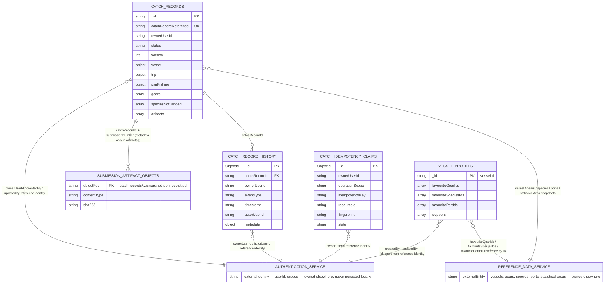

# Catch Recording Service — Data Schema

> Produced by Step 44 (`design/github-prompts/step-44-create-data-schema-documentation.md`; saved plan:
> `design/github-prompts/Step 44-create-data-schema-documentation-plan.md`). This is the single
> authoritative document describing **every item of data the Catch Recording Service itself persists** —
> every MongoDB collection and every object stored outside MongoDB. It is built entirely from the
> implementation, its tests, and index-creation code; where an existing focused document
> (`catch-recording-persistence.md`, `catch-recording-vessel-profiles.md`, `canonical-catch-record.md`,
> `catch-recording-submission-artifacts.md`) already covers an area in more operational detail, this
> document references it rather than duplicating it, but every fact below has been independently
> verified against the current code.

## Contents

1. [Purpose and persistence overview](#purpose-and-persistence-overview)
2. [Collection catalogue](#collection-catalogue)
   - [`catch-records`](#catch-records)
   - [`catch-record-history`](#catch-record-history)
   - [`catch-idempotency-claims`](#catch-idempotency-claims)
   - [`vessel-profiles`](#vessel-profiles)
   - [Operational and template collections](#operational-and-template-collections)
3. [Full catch record](#full-catch-record)
4. [Favourites storage](#favourites-storage)
5. [Accounts and authenticated identities](#accounts-and-authenticated-identities)
6. [Skippers storage](#skippers-storage)
7. [Lifecycle, history, submissions and artifacts](#lifecycle-history-submissions-and-artifacts)
8. [Index and constraint catalogue](#index-and-constraint-catalogue)
9. [Data relationships](#data-relationships)
10. [Data lifecycle and deletion](#data-lifecycle-and-deletion)
11. [Source-of-truth references](#source-of-truth-references)
12. [Known gaps or ambiguities](#known-gaps-or-ambiguities)

---

## Purpose and persistence overview

The Catch Recording Service persists data in exactly two places:

- **MongoDB** (`mongoDb` plugin, `src/plugins/mongodb.js`) — four Catch-Recording-owned collections:
  `catch-records`, `catch-record-history`, `catch-idempotency-claims`, `vessel-profiles`. Each collection
  has exactly one owning persistence module, enforced by `architecture-boundary.test.js` (no other module
  imports the `mongodb` driver or touches a collection directly).
- **An S3-compatible object store** (`src/catch-recording/artifact/s3-artifact-store.js`, via the AWS SDK
  `S3Client`) — the immutable bodies of committed submission artifacts (a JSON snapshot and a PDF
  receipt). Configured by the `catchArtifacts` convict block in `src/config.js` (`bucketName`, `region`,
  optional `endpoint`/`forcePathStyle` for the local `floci` emulator — see `compose.yml`).

**What is _not_ persisted by this service:**

- **Reference data** (vessels, gears, species, ports, statistical areas) is owned entirely by the external
  **Reference Data Service**. The Catch Recording Service only _resolves_ a reference by ID at the moment
  of use (`src/catch-recording/reference-data/*-client.js`, `reference-resolvers.js`) and copies a small,
  approved **display snapshot** (fields explicitly suffixed `Snapshot`, e.g. `nameSnapshot`,
  `codeSnapshot`, `rssSnapshot`) onto the catch record at write time. The snapshot is a point-in-time
  display copy, never a second authoritative source, and is never re-resolved or re-validated afterwards.
- **Authenticated identity** (accounts, users, sessions, tokens) is owned entirely by the external
  **Authentication Service**. See [Accounts and authenticated identities](#accounts-and-authenticated-identities).
- **Redis** appears only as local development infrastructure (`compose.yml`'s `redis` service). There is
  no Redis client import, configuration key, or call anywhere in `src/`. It is not used as an application
  cache, session store, or persistence layer by this service — the approved architecture has no
  application cache, regardless of the container/template being present locally.

| Technology                           | What it stores                                                             | Owning module(s)                                                                                                            |
| ------------------------------------ | -------------------------------------------------------------------------- | --------------------------------------------------------------------------------------------------------------------------- |
| MongoDB — `catch-records`            | The current, mutable operational Catch Record                              | `src/catch-recording/persistence/catch-persistence.js`, `catch-record-collection.js`, `catch-record-mapper.js`              |
| MongoDB — `catch-record-history`     | Append-only lifecycle/audit events                                         | `src/catch-recording/persistence/catch-history-persistence.js`, `catch-history-collection.js`, `catch-history-mapper.js`    |
| MongoDB — `catch-idempotency-claims` | Targeted duplicate-request claims for 7 named operations                   | `src/catch-recording/persistence/catch-idempotency-persistence.js`, `catch-idempotency-collection.js`                       |
| MongoDB — `vessel-profiles`          | Favourite gear/species/port IDs and vessel-owned skippers                  | `src/catch-recording/persistence/vessel-profile-persistence.js`, `vessel-profile-collection.js`, `vessel-profile-mapper.js` |
| MongoDB — `mongo-locks`              | Mutual-exclusion lock documents (`mongo-locks` npm package)                | `src/plugins/mongodb.js` (`LockManager`), `src/common/helpers/mongo-lock.js`                                                |
| MongoDB — `example-data`             | Scaffold/template collection only — **not** Catch Recording business data  | `src/plugins/mongodb.js`, `src/services/ExampleFind.js`                                                                     |
| S3-compatible object store           | Immutable JSON snapshot + PDF receipt bodies for each committed submission | `src/catch-recording/artifact/s3-artifact-store.js`, `catch-artifact.js`, `artifact-keys.js`                                |

---

## Collection catalogue

### `catch-records`

**Purpose.** The one mutable operational Catch Record per fishing trip/record. **Owning module:**
`src/catch-recording/persistence/catch-persistence.js` (public operations), `catch-record-collection.js`
(collection/index access), `catch-record-mapper.js` (canonical ⇄ document mapping).

**Document identity.** The canonical `id` (a server-generated UUID string, generated by the calling
business operation — e.g. `create-draft-catch-record.js` — never by the persistence module itself) is
stored directly as MongoDB's `_id`. MongoDB's automatic unique `_id` index is the only uniqueness
guarantee needed for this field.

**Top-level field dictionary** (every field is explicitly assigned by name in `catch-record-mapper.js` —
never an object spread):

| Field                   | Type                           | Required / nullable   | Default                          | Ownership                                                 | Notes                                                                                                                             |
| ----------------------- | ------------------------------ | --------------------- | -------------------------------- | --------------------------------------------------------- | --------------------------------------------------------------------------------------------------------------------------------- |
| `_id`                   | string (UUID)                  | required              | —                                | server-owned, generated by the calling business operation | Canonical `id`; immutable                                                                                                         |
| `schemaVersion`         | number                         | required              | `1` (`CANONICAL_SCHEMA_VERSION`) | server-owned                                              | Unsupported version fails mapping on read; no migration-on-read                                                                   |
| `catchRecordReference`  | string                         | required, non-empty   | generated                        | server-owned, immutable                                   | See [Full catch record](#full-catch-record) for format/generation                                                                 |
| `ownerUserId`           | string                         | required, non-empty   | —                                | server-owned, never client-supplied                       | External Authentication Service identity; see [Accounts](#accounts-and-authenticated-identities)                                  |
| `status`                | string enum                    | required              | `DRAFT` on creation              | server-owned                                              | Persisted values are exactly `DRAFT` \| `SUBMITTED` \| `COMPLETE` — see [Lifecycle](#lifecycle-history-submissions-and-artifacts) |
| `version`               | integer                        | required              | `1`                              | server-owned, optimistic concurrency                      | Incremented by exactly `1` via `$inc` on every successful mutation; never client-settable                                         |
| `numberOfSubmissions`   | integer                        | required              | `0`                              | server-owned                                              | Incremented on each successful submission                                                                                         |
| `hasUnsubmittedChanges` | boolean                        | required              | `false`                          | server-owned                                              | `true` after edit-start; cleared to `false` on submission                                                                         |
| `vessel`                | object (`VesselSnapshot`)      | required              | —                                | client-owned canonical section                            | See nested shape below                                                                                                            |
| `trip`                  | object (`Trip`)                | required              | —                                | client-owned canonical section                            | See nested shape below                                                                                                            |
| `pairFishing`           | object (`PairFishing`)         | required              | —                                | client-owned canonical section                            | See nested shape below                                                                                                            |
| `gears`                 | array (`GearAssociation[]`)    | required, one or more | —                                | client-owned canonical section                            | See nested shape below                                                                                                            |
| `speciesNotLanded`      | array (`SpeciesWeightEntry[]`) | required              | `[]`                             | client-owned canonical section                            | Root-level, trip-level; independent of `gears[].speciesCaught`                                                                    |
| `artifacts`             | array (`ArtifactMetadata[]`)   | required              | `[]`                             | server-owned, metadata only                               | Bodies stored in S3 — see [Artifacts](#lifecycle-history-submissions-and-artifacts)                                               |
| `createdAt`             | string (ISO-8601 UTC)          | required              | —                                | server-owned                                              | Set once, never updated                                                                                                           |
| `createdBy`             | string                         | required              | —                                | server-owned                                              | External identity that created the record                                                                                         |
| `updatedAt`             | string (ISO-8601 UTC)          | required              | —                                | server-owned, mutable                                     | The only audit field changed by the generic update primitive                                                                      |
| `updatedBy`             | string                         | required              | —                                | server-owned, mutable                                     | ditto                                                                                                                             |
| `submittedAt`           | string \| `null`               | required              | `null`                           | server-owned                                              | `null` until first submission                                                                                                     |
| `submittedBy`           | string \| `null`               | required              | `null`                           | server-owned                                              | ditto                                                                                                                             |
| `completedAt`           | string \| `null`               | required              | `null`                           | server-owned                                              | `null` until completion                                                                                                           |
| `completedBy`           | string \| `null`               | required              | `null`                           | server-owned                                              | ditto                                                                                                                             |

Server-owned field names are the single source of truth in
`src/catch-recording/domain/server-owned-fields.js` (`SERVER_OWNED_FIELDS`/`isServerOwnedField`); the
client-owned canonical sections are exactly `vessel`, `trip`, `pairFishing`, `gears`, `speciesNotLanded`.

**Nested structures.**

`vessel` (`VesselSnapshot`):

| Field                         | Type   | Required                                     |
| ----------------------------- | ------ | -------------------------------------------- |
| `id`                          | string | required — authoritative vessel reference ID |
| `rssSnapshot`                 | string | required                                     |
| `nameSnapshot`                | string | required                                     |
| `externalMarkSnapshot`        | string | required                                     |
| `lengthOverallMetresSnapshot` | number | optional                                     |

`trip`:

| Field                     | Type    | Required                       |
| ------------------------- | ------- | ------------------------------ |
| `startedAndFinishedToday` | boolean | required                       |
| `dateStarted`             | string  | required (date representation) |
| `dateEnded`               | string  | required                       |
| `departurePort`           | `Port`  | required                       |
| `returnPort`              | `Port`  | required                       |

`Port` (used for `departurePort`/`returnPort`): `{ id, codeSnapshot, nameSnapshot }` — all required strings.

`pairFishing`:

| Field             | Type    | Required                                                                                                                         |
| ----------------- | ------- | -------------------------------------------------------------------------------------------------------------------------------- |
| `enabled`         | boolean | required                                                                                                                         |
| `pairVessel`      | unknown | required; `null` when `enabled` is `false`. Populated shape when `true` is explicitly unresolved in the code — do not infer one. |
| `pairSkipperName` | unknown | required; same rule as above.                                                                                                    |

`gears[]` (`GearAssociation` — the authoritative root for all gear-dependent data):

| Field               | Type                   | Required                                                        |
| ------------------- | ---------------------- | --------------------------------------------------------------- |
| `associationId`     | string                 | required — relationship identity, distinct from `gear.id`       |
| `gear.id`           | string                 | required — authoritative gear reference ID                      |
| `gear.codeSnapshot` | string                 | required                                                        |
| `gear.nameSnapshot` | string                 | required                                                        |
| `characteristics`   | `Characteristic[]`     | required (may be empty)                                         |
| `statisticalArea`   | `StatisticalArea`      | required when the gear is complete; otherwise absent            |
| `speciesCaught`     | `SpeciesWeightEntry[]` | required (may be empty) — landed species caught under this gear |

`Characteristic`: `{ characteristicId, nameSnapshot, value: number|string|boolean, unitSnapshot? }` — exact
`value` type is deliberately broad and deferred.

`StatisticalArea`: `{ id, codeSnapshot, nameSnapshot }` — all required strings.

`SpeciesWeightEntry` (shared shape for `gears[].speciesCaught[]` **and** root `speciesNotLanded[]`):

| Field                      | Type                                   | Required / nullable                                                                                                        |
| -------------------------- | -------------------------------------- | -------------------------------------------------------------------------------------------------------------------------- |
| `id`                       | string                                 | required — authoritative species reference ID (the natural key; at most one occurrence per gear or per `speciesNotLanded`) |
| `faoCodeSnapshot`          | string                                 | required                                                                                                                   |
| `nameSnapshot`             | string                                 | required                                                                                                                   |
| `weightAboveMinimumKg`     | number \| `null`                       | optional, independently nullable                                                                                           |
| `weightBelowMinimumKg`     | number \| `null`                       | optional, independently nullable                                                                                           |
| `weightLegallyDiscardedKg` | number \| `null`                       | optional, independently nullable                                                                                           |
| `weightPrecision`          | `'wholeNumber'` \| `'oneDecimalPlace'` | optional                                                                                                                   |

`artifacts[]` (`ArtifactMetadata`, metadata only — see [Lifecycle](#lifecycle-history-submissions-and-artifacts) for the full persisted shape including `contentType`/`contentLength`/`checksum`).

**Validation and business rules.** Persistence performs only _structural_ safety checks on read
(`toCanonicalRecord`): the document must be an object; `schemaVersion` must be supported; `_id`,
`catchRecordReference`, `ownerUserId` must be non-empty strings; `status` must be one of the three
persisted statuses; `gears` must be an array. This is not a re-run of full business validation (owned by
`src/catch-recording/validation/`) — a malformed document fails safely into
`MALFORMED_CATCH_RECORD_DOCUMENT` rather than exposing the raw document.

**Ownership and access partitioning.** Every owner-scoped read/write filters on `{ _id, ownerUserId }`
directly in the MongoDB query — ownership is never a post-query comparison, and a wrong owner is
indistinguishable from "not found" (`null`), preventing horizontal enumeration.

**Creation, update, deletion.**

- **Create** (`createCatchRecord`) — one `insertOne`. Duplicate `_id` or duplicate `catchRecordReference`
  (Mongo error `11000`) is distinguished by `keyPattern` and translated to `DUPLICATE_CATCH_RECORD_ID` /
  `DUPLICATE_CATCH_RECORD_REFERENCE`.
- **Update** — four atomic `findOneAndUpdate` primitives, each embedding identity + ownership (where
  applicable) + `version: expectedVersion` + a lifecycle-eligibility predicate in the same query, and each
  `$inc`-ing `version` by exactly `1` on success:
  - `applyAuditMetadataUpdate` — `updatedAt`/`updatedBy` only.
  - `applySectionUpdate` — exactly one of `vessel`/`trip`/`pairFishing`/`gears`/`speciesNotLanded` plus
    audit fields; predicate requires `status: DRAFT`.
  - `applyCompleteReplacement` — every client-owned section at once (mobile full-replacement); predicate
    requires `status: DRAFT`.
  - `applySubmission` / `applyCompletion` / `applyEditStart` — the submission, completion and edit-start
    primitives (see [Lifecycle](#lifecycle-history-submissions-and-artifacts)).
- **Delete** — `deleteEligibleDraftForOwner` **physically deletes** a document, but only an eligible,
  never-submitted `DRAFT` (abandonment). This is the **only** hard delete anywhere in this collection;
  there is no soft-delete/tombstone field.

**Indexes** — see [Index and constraint catalogue](#index-and-constraint-catalogue).

**Retention.** Indefinite, except for abandonment (physical delete of an eligible draft). No TTL index.

---

### `catch-record-history`

**Purpose.** A simple, append-only record of approved lifecycle/audit event concepts for display and
audit — explicitly **not** event sourcing, not the operational source of truth, and never used to
reconstruct Catch Record state. **Owning module:** `catch-history-persistence.js` (public API),
`catch-history-collection.js`, `catch-history-mapper.js`, `catch-history-event.js` (framework-neutral
input contract).

**Document identity.** MongoDB `ObjectId`, auto-generated on insert; exposed to callers as a hex-string
`id` (`.toHexString()`), never a raw `ObjectId` instance. No caller-supplied unique identifier exists.

**Field dictionary.**

| Field           | Type                                | Required            | Notes                                                                                  |
| --------------- | ----------------------------------- | ------------------- | -------------------------------------------------------------------------------------- |
| `_id`           | ObjectId                            | generated           | Mapped to public `id` (hex string) on read                                             |
| `catchRecordId` | string                              | required, non-empty | The owning Catch Record's canonical `id`                                               |
| `ownerUserId`   | string                              | required, non-empty | Trusted owner identity; part of every read filter                                      |
| `eventType`     | string enum                         | required            | One of `CATCH_HISTORY_EVENT_TYPES` (below)                                             |
| `timestamp`     | string (ISO-8601 UTC, `Z`-suffixed) | required            | Server-generated by the **calling business operation**; this module never generates it |
| `actorUserId`   | string                              | required, non-empty | Trusted acting identity                                                                |
| `metadata`      | object                              | optional            | Exactly two allow-listed optional keys (below) — any other key throws a `TypeError`    |

`metadata` allow-list:

| Key                | Type    | Rule                                                                                                                      |
| ------------------ | ------- | ------------------------------------------------------------------------------------------------------------------------- |
| `section`          | string  | One of the six canonical nested section names (`vessel`, `trip`, `pairFishing`, `gears`, `speciesNotLanded`, `artifacts`) |
| `submissionNumber` | integer | Bounded `1`–`1000`                                                                                                        |

**Event types** (`CATCH_HISTORY_EVENT_TYPES`): `DRAFT_CREATED`, `SECTION_SAVED`, `DRAFT_ABANDONED`,
`SUBMITTED`, `COMPLETED`, `EDIT_STARTED`, `AMENDMENT_SECTION_SAVED`, `RESUBMITTED`,
`COMPLETE_REPLACEMENT_SAVED`. As of this document, producers exist only for `DRAFT_CREATED`,
`SECTION_SAVED`, and `COMPLETE_REPLACEMENT_SAVED`; the remaining six are reserved event names with no
current producer.

**Validation and business rules.** Enforced entirely by `catch-history-event.js`'s
`validateHistoryEventInput`/`assertSafeHistoryMetadata` before the document is ever built — a structural
`TypeError`, not a public `ApplicationError` (trusted-internal-caller contract, mirroring
`persistence-guards.js`).

**Relationships.** `catchRecordId` references a `catch-records` document (no foreign-key enforcement —
MongoDB has none; the relationship is maintained entirely by the calling business operation).

**Creation, update, deletion.** Insert-only: `appendCatchHistoryEvent` calls `insertOne` and nothing else.
No update, replace, upsert, or delete method exists anywhere in this module
(`architecture-boundary.test.js` enforces this by exported-function-name check).

**Retention.** Indefinite — no retention policy is approved or implemented.

---

### `catch-idempotency-claims`

**Purpose.** Targeted duplicate-request detection for exactly seven named operations — answers "has this
duplicate-consequence operation already been claimed or completed for this scoped key and semantic
request?", never a general concurrency or replay cache. **Owning module:**
`catch-idempotency-persistence.js`, `catch-idempotency-collection.js`,
`idempotency-key.js`/`idempotency-fingerprint.js`/`idempotency-operation-scope.js` (framework-neutral
contracts).

**Document identity.** The composite unique index (below) is the identity; MongoDB also assigns an
automatic `_id` (`ObjectId`), which is never surfaced to callers.

**Field dictionary.**

| Field            | Type                         | Required                      | Notes                                                                                                                                                           |
| ---------------- | ---------------------------- | ----------------------------- | --------------------------------------------------------------------------------------------------------------------------------------------------------------- |
| `ownerUserId`    | string                       | required, non-empty           | Cross-caller isolation                                                                                                                                          |
| `operationScope` | string enum                  | required                      | One of the seven `IDEMPOTENCY_OPERATION_SCOPES` (below)                                                                                                         |
| `idempotencyKey` | string                       | required                      | Opaque, client-generated; printable ASCII, 1–200 chars; no trimming/case conversion                                                                             |
| `resourceId`     | string                       | always stored                 | Caller-supplied, or an internal sentinel (`'\u0000NO_RESOURCE\u0000'`, never exposed) when the caller omits it                                                  |
| `fingerprint`    | string                       | required                      | 64-character lowercase hex SHA-256 digest of `{ operationScope, idempotencyKey, semanticInput }`                                                                |
| `state`          | `'PENDING'` \| `'COMPLETED'` | required                      | No third state, no retry counter, no lock-lease field                                                                                                           |
| `createdAt`      | string (ISO-8601)            | required                      | Server-generated at claim time                                                                                                                                  |
| `completedAt`    | string (ISO-8601)            | present only once `COMPLETED` | Server-generated on completion                                                                                                                                  |
| `result`         | object                       | present only once `COMPLETED` | Minimal allow-listed replay facts only — supplied per-call by the caller's own `allowedResultFields`; never a Catch Record, artifact body, token, or credential |

**Operation-scope enum** (`IDEMPOTENCY_OPERATION_SCOPES`, closed set): `DRAFT_CREATION`, `SUBMISSION`,
`EDIT_START`, `RESUBMISSION`, `ADD_FAVOURITE`, `ADD_SKIPPER`, `COMPLETION`. Ordinary section-PATCH
operations are explicitly excluded.

**Validation and business rules.** `computeRequestFingerprint` canonicalises `semanticInput` (recursively
sorted object keys, array order preserved, max nesting depth 5, every key must be an exact subset of the
caller-supplied `allowedFields`) before hashing — structurally excluding secrets, tokens, headers, and
per-retry timestamps.

**Creation, update, deletion.**

- **Create (claim)** — `claimIdempotency` attempts one `insertOne`; the unique index is the only
  uniqueness guard (never an application-level check-then-insert). A duplicate-key error is classified
  into `REPLAY` (fingerprint matches, `COMPLETED`), `IN_PROGRESS` (fingerprint matches, `PENDING`), or
  throws `IDEMPOTENCY_CONFLICT` (fingerprint differs).
- **Update (complete)** — `completeIdempotencyClaim` atomically transitions a matching `PENDING` claim to
  `COMPLETED` in one `findOneAndUpdate`. A repeated identical completion is a deterministic no-op; a
  different result or no matching claim both throw safely rather than overwrite.
- **Delete** — no delete operation exists anywhere in this module.

**Retention — explicitly not implemented.** No `expiresAt` field, no TTL index, no cleanup job. This is a
declined decision, not an oversight (`docs/configuration-decisions.md` records "no retention period is
approved anywhere") — **an owner decision is required before production use** or before any later
operation first depends on a bounded replay window.

---

### `vessel-profiles`

**Purpose.** Local, vessel-owned Catch Recording convenience data — favourite gear/species/port reference
IDs and vessel-owned skippers — associated with (but never modifying) an authoritative vessel ID.
**Owning module:** `vessel-profile-persistence.js`, `vessel-profile-collection.js`,
`vessel-profile-mapper.js`.

**Document identity.** The authoritative vessel ID itself, stored directly as `_id` — exactly one profile
document per vessel. MongoDB's automatic unique `_id` index is the only index this collection needs or
has.

**Field dictionary (persisted document — distinct from the public response shape below).**

| Field                 | Type              | Required                      | Notes                                                                |
| --------------------- | ----------------- | ----------------------------- | -------------------------------------------------------------------- |
| `_id`                 | string            | required                      | The vessel ID; public responses expose this as `vesselId`            |
| `favouriteGearIds`    | string[]          | defaults to `[]` on first use | Reference IDs only — never a reference-data snapshot                 |
| `favouriteSpeciesIds` | string[]          | defaults to `[]` on first use | ditto                                                                |
| `favouritePortIds`    | string[]          | defaults to `[]` on first use | ditto                                                                |
| `skippers`            | object[]          | defaults to `[]` on first use | See [Skippers storage](#skippers-storage) for the full element shape |
| `createdAt`           | string (ISO-8601) | set on first insert           | Profile-level audit field                                            |
| `createdBy`           | string            | set on first insert           | External actor identity that first created the profile               |
| `updatedAt`           | string (ISO-8601) | mutable on every write        |                                                                      |
| `updatedBy`           | string            | mutable on every write        |                                                                      |

**No document exists until the first favourite/skipper addition.** `findVesselProfile` never returns
`null` and never a not-found error — "no favourites or skippers yet" is a valid state, represented as the
default empty profile (all arrays `[]`) whether or not a document actually exists yet.

**Validation and business rules.** See the Joi schemas in `src/routes/vessel-profiles.js`: `vesselId` and
every favourite ID are required trimmed non-empty strings (no UUID/format constraint); skipper `name` is
required, 1–100 chars; `phoneNumber` is optional, 1–30 chars (length-only — no telephone-format pattern);
`email` is optional, validated as an email, max 254 chars. Favourite IDs are additionally validated for
existence/selectability against the Reference Data Service (`resolveGear`/`resolveSpecies`/`resolvePort`)
_before_ persistence — an invalid/inactive reference is rejected with `INVALID_FAVOURITE_SELECTION` and
never reaches the database.

**Ownership and access partitioning.** There is **no** `ownerUserId`/account field on this document — a
vessel profile is not owned by a single user. Access is gated per-request by
`decideVesselProfileAccess`/`decideVesselAccess`: the authenticated caller's `userId` must appear in the
trusted `accessibleVesselIds` fact (resolved from the Reference Data Service) for the requested vessel.
`createdBy`/`updatedBy` on the profile and on each skipper are audit metadata (which identity performed
the write), not an ownership relationship.

**Creation, update, deletion.**

- **Favourite add** — one atomic `findOneAndUpdate({ _id: vesselId }, { $addToSet: { [field]: id }, ... }, { upsert: true })`.
  `$addToSet` is itself the complete duplicate-prevention/idempotency mechanism.
- **Favourite remove** — one atomic `findOneAndUpdate({ _id }, { $pull: { [field]: id } })`, never
  `upsert` — a safe no-op if the profile or ID does not exist.
- **Skipper add** — see [Skippers storage](#skippers-storage).
- **Skipper remove** — one atomic `findOneAndUpdate({ _id }, { $pull: { skippers: { id: skipperId } } })`,
  never `upsert`.
- **Whole-profile deletion** — **no operation exists**. Only individual favourite/skipper array elements
  can ever be removed; the profile document itself is never deleted.

**Indexes.** None beyond MongoDB's automatic unique `_id` index — `ensureVesselProfileIndexes` is an
intentional no-op (kept only so `src/plugins/mongodb.js`'s composition is uniform).

**Retention.** Indefinite, including when every array is empty — no TTL index, no purge on vessel
inactivity or access-loss.

---

### Operational and template collections

| Collection     | Purpose                                                                                                                                                                                                                    | Business data?                                                                  |
| -------------- | -------------------------------------------------------------------------------------------------------------------------------------------------------------------------------------------------------------------------- | ------------------------------------------------------------------------------- |
| `mongo-locks`  | Mutual-exclusion lock documents used by the `mongo-locks` npm package's `LockManager` (`server.locker`/`request.locker`), wrapped by `src/common/helpers/mongo-lock.js`'s `acquireLock`/`requireLock`. Index: `{ id: 1 }`. | No — operational infrastructure only, not Catch Recording domain data.          |
| `example-data` | A scaffold/template collection and index (`{ id: 1 }`) left over from the generic CDP service template (`src/services/ExampleFind.js`), explicitly commented "Remove as required" in `src/plugins/mongodb.js`.             | No — not real service data; do not treat as part of the Catch Recording schema. |

---

## Full catch record

A complete, realistic **persisted** (not API-DTO) example of a submitted Catch Record, labelled
illustrative, assembled directly from the real, tested fixtures in
`src/catch-recording/domain/__fixtures__/canonical-catch-record.fixtures.js` (`submittedExample`),
extended with one additional gear association, a second landed species, and a non-landed species so every
coexistable structure is represented in one document:

```json
{
  "_id": "5f9c6586-3bf0-4fbb-95d8-ef2cf9c1d9af",
  "schemaVersion": 1,
  "catchRecordReference": "GBR-RSS123456-051026-113500",
  "ownerUserId": "e0ec9737-908e-4749-97e0-41caf19de2c2",
  "status": "SUBMITTED",
  "version": 3,
  "numberOfSubmissions": 1,
  "hasUnsubmittedChanges": false,
  "vessel": {
    "id": "0fe4d4aa-22f8-449e-89c9-b7052bae8667",
    "rssSnapshot": "RSS123456",
    "nameSnapshot": "EXAMPLE VESSEL",
    "externalMarkSnapshot": "PH123",
    "lengthOverallMetresSnapshot": 8.74
  },
  "trip": {
    "startedAndFinishedToday": true,
    "dateStarted": "2026-10-05",
    "dateEnded": "2026-10-05",
    "departurePort": {
      "id": "462e3de0-8d5e-422a-aaed-220da112ca81",
      "codeSnapshot": "0349",
      "nameSnapshot": "Plymouth"
    },
    "returnPort": {
      "id": "462e3de0-8d5e-422a-aaed-220da112ca81",
      "codeSnapshot": "0349",
      "nameSnapshot": "Plymouth"
    }
  },
  "pairFishing": {
    "enabled": false,
    "pairVessel": null,
    "pairSkipperName": null
  },
  "gears": [
    {
      "associationId": "b5ca27d2-8e5f-4920-89a5-d4756829b44e",
      "gear": {
        "id": "f3c85f59-1196-43da-b74b-909f7d7be451",
        "codeSnapshot": "TBB",
        "nameSnapshot": "Beam Trawl"
      },
      "characteristics": [
        {
          "characteristicId": "number-of-times-gear-shot",
          "nameSnapshot": "Number of Times Gear Shot",
          "value": 2
        },
        {
          "characteristicId": "cb6adafd-ce57-4960-95a8-5d463007e63f",
          "nameSnapshot": "Mesh Size",
          "value": 9,
          "unitSnapshot": "mm"
        }
      ],
      "statisticalArea": {
        "id": "12639177-7614-4616-83cd-6141ecb83924",
        "codeSnapshot": "46F45",
        "nameSnapshot": "ICES 46F45"
      },
      "speciesCaught": [
        {
          "id": "60628fcb-97af-40d0-b992-099216c8fc40",
          "faoCodeSnapshot": "COD",
          "nameSnapshot": "Atlantic Cod",
          "weightAboveMinimumKg": 120.5,
          "weightBelowMinimumKg": 4,
          "weightLegallyDiscardedKg": null,
          "weightPrecision": "oneDecimalPlace"
        }
      ]
    }
  ],
  "speciesNotLanded": [
    {
      "id": "WHG",
      "faoCodeSnapshot": "WHG",
      "nameSnapshot": "Whiting",
      "weightAboveMinimumKg": 6.5,
      "weightBelowMinimumKg": null,
      "weightLegallyDiscardedKg": null,
      "weightPrecision": "oneDecimalPlace"
    }
  ],
  "artifacts": [
    {
      "submissionNumber": 1,
      "type": "JSON_SNAPSHOT",
      "contentType": "application/json; charset=utf-8",
      "contentLength": 2184,
      "checksum": "b94d27b9934d3e08a52e52d7da7dabfac484efe37a5380ee9088f7ace2efcde9"
    },
    {
      "submissionNumber": 1,
      "type": "PDF_RECEIPT",
      "contentType": "application/pdf",
      "contentLength": 48213,
      "checksum": "4e07408562bedb8b60ce05c1decfe3ad16b72230967de01f640b7e4729b49fce"
    }
  ],
  "createdAt": "2026-10-05T10:35:00Z",
  "createdBy": "e0ec9737-908e-4749-97e0-41caf19de2c2",
  "updatedAt": "2026-10-05T12:15:00Z",
  "updatedBy": "e0ec9737-908e-4749-97e0-41caf19de2c2",
  "submittedAt": "2026-10-05T12:15:00Z",
  "submittedBy": "e0ec9737-908e-4749-97e0-41caf19de2c2",
  "completedAt": null,
  "completedBy": null
}
```

_(Illustrative values only — IDs, snapshots and checksums above are synthetic, not real production data.
`artifacts[].contentType`/`contentLength`/`checksum` are populated here to show the full submitted shape;
see [Lifecycle, history, submissions and artifacts](#lifecycle-history-submissions-and-artifacts) for
where these three fields are actually written.)_

### `catchRecordReference` — format, generation, uniqueness, immutability

- **Format**: `GBR-{RSS}-{DDMMYY}-{HHMMSS}`, matched by the exported pattern
  `CATCH_RECORD_REFERENCE_PATTERN` in `src/catch-recording/domain/catch-record-reference.js`. `{RSS}` is
  the vessel's authoritative registration number, approved-normalised (uppercased, non-alphanumeric
  characters stripped); the date/time components are rendered in the approved business timezone
  (`businessTimezone` config, default `Europe/London`), fully DST-aware via `Intl.DateTimeFormat`.
- **Generation**: `generateCatchRecordReference` builds the candidate from a server-controlled clock only
  (never a client-supplied timestamp) and checks it against a trusted `referenceExists` function (backed
  by `findCatchRecordByReference`). On a collision, it retries at the next second-resolution timestamp,
  bounded to `MAX_REFERENCE_GENERATION_ATTEMPTS` (`5`) attempts, then throws `DUPLICATE_RESOURCE`
  (`CATCH_RECORD_REFERENCE_GENERATION_FAILED`).
- **Client-supplied reference (draft creation only)**: `create-draft-catch-record.js` additionally
  accepts an optional client-supplied `catchRecordReference` on the one creation request. When supplied,
  it is validated against the exact same `CATCH_RECORD_REFERENCE_PATTERN` format and checked for
  uniqueness via `findCatchRecordByReference` before being persisted as-is — the server never silently
  rewrites a client-supplied value, and an invalid format or an existing value is rejected before any
  record is created.
- **Uniqueness**: enforced by the `{ catchRecordReference: 1 }` unique MongoDB index — the authoritative
  guarantee, independent of either generation path above.
- **Immutability**: `catchRecordReference` is server-owned (`SERVER_OWNED_FIELDS`) and is never one of the
  allow-listed fields any update primitive (`applyAuditMetadataUpdate`, `applySectionUpdate`,
  `applyCompleteReplacement`, `applySubmission`, `applyCompletion`, `applyEditStart`) can change — once
  persisted, it never changes for the life of the record.

---

## Favourites storage

Favourites are stored and returned as **stable reference IDs only** — never a stored or re-resolved
reference-data snapshot (confirmed in `vessel-favourites.js` and the persistence `$addToSet` calls, which
write only the supplied ID). `GET` returns `{ vesselId, favourite<Type>Ids }`; `POST` validates the ID
against the Reference Data Service (requiring it to be active/selectable) before persisting, and returns
`200 OK` idempotently whether or not the ID was already present; `DELETE` always returns `204 No Content`.

**Persisted JSON example** (the `vessel-profiles` document, favourite fields only):

```json
{
  "_id": "0fe4d4aa-22f8-449e-89c9-b7052bae8667",
  "favouriteGearIds": ["f3c85f59-1196-43da-b74b-909f7d7be451"],
  "favouriteSpeciesIds": ["60628fcb-97af-40d0-b992-099216c8fc40"],
  "favouritePortIds": ["462e3de0-8d5e-422a-aaed-220da112ca81"],
  "skippers": [],
  "createdAt": "2026-10-01T09:00:00.000Z",
  "createdBy": "e0ec9737-908e-4749-97e0-41caf19de2c2",
  "updatedAt": "2026-10-01T09:00:00.000Z",
  "updatedBy": "e0ec9737-908e-4749-97e0-41caf19de2c2"
}
```

**Public response shape** (`GET /v1/vessels/{vesselId}/favourite-gears`):

```json
{
  "vesselId": "0fe4d4aa-22f8-449e-89c9-b7052bae8667",
  "favouriteGearIds": ["f3c85f59-1196-43da-b74b-909f7d7be451"]
}
```

- **Add/remove behaviour**: atomic `$addToSet` (add, `upsert: true`) / `$pull` (remove, never `upsert`).
- **Duplicate prevention**: `$addToSet` itself — no separate check-then-insert.
- **Indexes**: none dedicated to favourites — only the collection's automatic unique `_id` index.
- **Validation**: `vesselId`/favourite ID are required trimmed non-empty strings (Joi, `src/routes/vessel-
profiles.js`); the ID is additionally resolved and must be active/selectable in the Reference Data
  Service before persistence.

---

## Accounts and authenticated identities

**The Catch Recording Service owns no account, user, session, or authenticated-identity collection of its
own.** There is no MongoDB collection anywhere in the codebase for accounts, users, credentials, sessions,
or tokens.

Authenticated identity is resolved **per-request** from the external **Authentication Service**:

1. `authentication-scheme.js` reads the inbound `Authorization` bearer token.
2. `authentication-client.js` calls `POST {authentication.baseUrl}/validate` on the external service.
3. `authentication-context.js` builds a small, frozen, **transient, in-memory** context —
   `{ userId, scopes }` only — placed on `request.auth.credentials`. No raw token, claims, profile, or
   session data is retained, and nothing here is written to MongoDB or any other store.

**What this service _does_ persist** is the resulting external `userId` value, as a plain reference field
on other collections' documents — never as a locally managed identity record:

| Field                         | Appears on                                                          | Meaning                                                                                                                                 |
| ----------------------------- | ------------------------------------------------------------------- | --------------------------------------------------------------------------------------------------------------------------------------- |
| `ownerUserId`                 | `catch-records`, `catch-record-history`, `catch-idempotency-claims` | The external identity that owns/claims the resource; used directly in MongoDB ownership filters                                         |
| `actorUserId`                 | `catch-record-history`                                              | The external identity that performed the event (may differ from the record's owner in principle; always supplied by the trusted caller) |
| `createdBy` / `updatedBy`     | `catch-records`, `vessel-profiles` (profile and each skipper)       | Audit-only: which external identity performed the write                                                                                 |
| `submittedBy` / `completedBy` | `catch-records`                                                     | Audit-only: which external identity performed that lifecycle transition                                                                 |

`vessel-profiles` has **no** ownership field at all (see [`vessel-profiles`](#vessel-profiles) above) —
access is gated by vessel-level permission (`accessibleVesselIds`), not by a stored user relationship.

No JSON example is included for "an account" because no such persisted entity exists in this service.

---

## Skippers storage

Skippers are vessel-owned local entries, embedded in the `skippers` array of the `vessel-profiles`
document (see [`vessel-profiles`](#vessel-profiles)). There is no separate skipper collection.

**Persisted skipper shape** (`buildSkipperDocument`, `vessel-profile-persistence.js`):

| Field            | Type              | Notes                                                                                                                         |
| ---------------- | ----------------- | ----------------------------------------------------------------------------------------------------------------------------- |
| `id`             | string (UUID)     | Always server-generated (`randomUUID()`) — never client-supplied                                                              |
| `name`           | string            | As supplied, trimmed                                                                                                          |
| `normalisedName` | string            | **Internal only** — `name.trim().toLowerCase()`; the case-insensitive duplicate-detection key; never returned in any response |
| `phoneNumber`    | string \| `null`  | Optional at the API boundary; stored as `null` when omitted                                                                   |
| `email`          | string \| `null`  | Optional at the API boundary; stored as `null` when omitted                                                                   |
| `createdAt`      | string (ISO-8601) | Set once, on first add                                                                                                        |
| `createdBy`      | string            | External actor identity that added the skipper                                                                                |
| `updatedAt`      | string (ISO-8601) | Currently only ever equals `createdAt` — no skipper update endpoint exists                                                    |
| `updatedBy`      | string            | ditto                                                                                                                         |

**Public response shape** (every list/add response): `{ id, name, phoneNumber, email }` only —
`normalisedName` and all four audit fields are stripped by `vessel-profile-mapper.js`'s
`toCanonicalProfile`/`mapStoredSkipper` before ever leaving persistence.

**Persisted JSON example** (one `vessel-profiles` document, skippers only):

```json
{
  "_id": "0fe4d4aa-22f8-449e-89c9-b7052bae8667",
  "favouriteGearIds": [],
  "favouriteSpeciesIds": [],
  "favouritePortIds": [],
  "skippers": [
    {
      "id": "7c1e2b2a-2f0e-4a4e-9f62-2a1d7c5e9b10",
      "name": "Jane Doe",
      "normalisedName": "jane doe",
      "phoneNumber": "01234567890",
      "email": "jane.doe@example.com",
      "createdAt": "2026-10-01T09:05:00.000Z",
      "createdBy": "e0ec9737-908e-4749-97e0-41caf19de2c2",
      "updatedAt": "2026-10-01T09:05:00.000Z",
      "updatedBy": "e0ec9737-908e-4749-97e0-41caf19de2c2"
    }
  ],
  "createdAt": "2026-10-01T09:05:00.000Z",
  "createdBy": "e0ec9737-908e-4749-97e0-41caf19de2c2",
  "updatedAt": "2026-10-01T09:05:00.000Z",
  "updatedBy": "e0ec9737-908e-4749-97e0-41caf19de2c2"
}
```

**Public response shape** (`GET`/`POST /v1/vessels/{vesselId}/skippers`):

```json
{
  "vesselId": "0fe4d4aa-22f8-449e-89c9-b7052bae8667",
  "skippers": [
    {
      "id": "7c1e2b2a-2f0e-4a4e-9f62-2a1d7c5e9b10",
      "name": "Jane Doe",
      "phoneNumber": "01234567890",
      "email": "jane.doe@example.com"
    }
  ]
}
```

**Validation rules**: `name` required, 1–100 chars; `phoneNumber` optional, 1–30 chars (length-only, no
format pattern); `email` optional, validated as an email, max 254 chars (`src/routes/vessel-profiles.js`).

**Add behaviour**: one atomic `findOneAndUpdate({ _id: vesselId, 'skippers.normalisedName': { $ne: normalisedName } }, { $push: { skippers: skipperDocument } }, { upsert: true })`.
A resulting duplicate-key error (`11000`, on `_id`) is disambiguated by one follow-up read: either the
named skipper already exists for this vessel (idempotent — the current profile is returned unchanged,
ignoring the new request's phone/email) or a concurrent request created the profile for the first time (a
bounded single retry of the identical update, `MAX_SKIPPER_ADD_ATTEMPTS = 2`).

**List/delete behaviour**: `GET` lists the public shape of every skipper; `DELETE` uses one atomic `$pull`
by `id`, never `upsert`, always returning `204 No Content`.

**No skipper update endpoint exists** — resolved decision (`docs/configuration-decisions.md`), not an
oversight.

**Indexes/uniqueness**: no dedicated index — skipper-name uniqueness is enforced entirely by the atomic
update filter above, not by a secondary collection-level index.

---

## Lifecycle, history, submissions and artifacts

### Persisted vs. derived statuses

Only `DRAFT`, `SUBMITTED`, `COMPLETE` are ever persisted (`PERSISTED_STATUSES`, `lifecycle-status.js`).
`DRAFT_EDIT`, `AMENDED`, `ABANDONED`, `WITHDRAWN` are **never** persisted status values:

| Persisted `status` | Condition                   | Derived display status (`display-status.js`, never stored) |
| ------------------ | --------------------------- | ---------------------------------------------------------- |
| `DRAFT`            | `numberOfSubmissions === 0` | `Draft`                                                    |
| `DRAFT`            | `numberOfSubmissions > 0`   | `Amended`                                                  |
| `SUBMITTED`        | —                           | `Submitted`                                                |
| `COMPLETE`         | —                           | `Complete`                                                 |

"Abandoned" is represented as **physical deletion** of an eligible never-submitted draft
(`deleteEligibleDraftForOwner`), not a stored status value.

### Amendments and resubmissions

A `SUBMITTED`/`COMPLETE` record returns to `DRAFT` via `applyEditStart` (sets `status: DRAFT`,
`hasUnsubmittedChanges: true`; every other field — `numberOfSubmissions`, `artifacts`, prior
submission/completion metadata — survives untouched). A subsequent `applySubmission` call
(`RESUBMISSION`) reuses the identical atomic primitive as first submission; both source states are
persisted `DRAFT`.

### History events

See the full [`catch-record-history`](#catch-record-history) catalogue above for the complete event-type
list and metadata shape.

### Submission artifacts — the database/object-storage boundary

On each successful submission, exactly two **immutable** artifacts are produced per `submissionNumber`:
one JSON snapshot and one PDF receipt.

**Deterministic S3 object keys** (`artifact-keys.js`):

```text
catch-records/{catchRecordId}/submissions/{submissionNumber}/snapshot.json
catch-records/{catchRecordId}/submissions/{submissionNumber}/receipt.pdf
```

Built only from the server-controlled Catch Record ID, submission number (bounded integer, 1–1000), and
the approved artifact type — never from client-supplied input. The S3 object itself carries the file
bytes, an `application/json; charset=utf-8` or `application/pdf` `Content-Type`, and a `sha256` value in
its own object metadata.

**MongoDB stores metadata only**, appended to the Catch Record's own `artifacts[]` array (`catch-
artifact.js`):

| Field              | Type                                 | Notes                                                                                                                               |
| ------------------ | ------------------------------------ | ----------------------------------------------------------------------------------------------------------------------------------- |
| `submissionNumber` | integer                              | 1–1000                                                                                                                              |
| `type`             | `'JSON_SNAPSHOT'` \| `'PDF_RECEIPT'` | Closed set                                                                                                                          |
| `contentType`      | string                               | The deterministic, server-computed content type — never trusted from the object's own stored metadata                               |
| `contentLength`    | integer                              | Byte length                                                                                                                         |
| `checksum`         | string                               | SHA-256 hex digest, independently persisted in MongoDB (separate from — but equal to — the S3 object's own `sha256` metadata value) |

**MongoDB never stores**: the bucket name, the S3 endpoint, the object key, the JSON body, the PDF bytes,
or a storage-provider object-version ID.

**Commit sequencing (not one distributed transaction).** `submit-catch-record.js` first writes both
immutable objects to S3 (`storeSubmissionArtifacts`), **then** calls `applySubmission` to atomically add
both metadata entries to the Catch Record document in one MongoDB update. The MongoDB metadata update
itself is atomic (both entries land in the same `findOneAndUpdate`), but the overall two-system sequence
is **not** — a successful S3 write followed by a failed MongoDB update can leave an orphaned S3 object.
Deterministic keys and a pre-write checksum comparison (the S3 adapter checks for an existing object and
rejects a different checksum rather than silently overwriting) support recovery, but do not provide
cross-system atomicity. [`catch-recording-submission-artifacts.md`](./catch-recording-submission-artifacts.md)'s
reference to `applySubmission` "always commit\[ting\] both entries in one atomic write" describes the
MongoDB update only, not the full S3-plus-MongoDB sequence — see
[Known gaps or ambiguities](#known-gaps-or-ambiguities).

**Listing/retrieval safety.** `GET /v1/catch-records/{id}/submissions` is built entirely from the Catch
Record's own trusted `artifacts[]` metadata and never calls object storage. A submission is listed only
when both approved artifact types are present for its submission number. Retrieval always recomputes the
deterministic key from trusted inputs and checks it against `artifacts[]` before ever calling S3 — a
client can never probe object storage with an arbitrary, uncommitted key.

---

## Index and constraint catalogue

| Collection                 | Index                                                                     | Type                       | Source                                                                                         |
| -------------------------- | ------------------------------------------------------------------------- | -------------------------- | ---------------------------------------------------------------------------------------------- |
| `catch-records`            | `{ _id: 1 }`                                                              | Unique (MongoDB automatic) | Not manually created                                                                           |
| `catch-records`            | `{ catchRecordReference: 1 }`                                             | Unique                     | `catch-record-collection.js` (`ensureCatchRecordIndexes`)                                      |
| `catch-records`            | `{ ownerUserId: 1, createdAt: -1, _id: 1 }`                               | Compound, non-unique       | `catch-record-collection.js` (`ensureCatchRecordIndexes`)                                      |
| `catch-record-history`     | `{ _id: 1 }`                                                              | Unique (MongoDB automatic) | Not manually created                                                                           |
| `catch-record-history`     | `{ catchRecordId: 1, ownerUserId: 1, timestamp: 1, _id: 1 }`              | Compound, non-unique       | `catch-history-collection.js` (`ensureCatchHistoryIndexes`)                                    |
| `catch-idempotency-claims` | `{ ownerUserId: 1, operationScope: 1, idempotencyKey: 1, resourceId: 1 }` | Compound, **unique**       | `catch-idempotency-collection.js` (`ensureCatchIdempotencyIndexes`)                            |
| `vessel-profiles`          | `{ _id: 1 }`                                                              | Unique (MongoDB automatic) | `vessel-profile-collection.js` (`ensureVesselProfileIndexes` is an explicit no-op beyond this) |
| `mongo-locks`              | `{ id: 1 }`                                                               | Non-unique                 | `src/plugins/mongodb.js`                                                                       |
| `example-data`             | `{ id: 1 }`                                                               | Non-unique                 | `src/plugins/mongodb.js` (template collection)                                                 |

No text, wildcard, partial, sparse, or TTL index exists anywhere in the service.

---

## Data relationships



---

## Data lifecycle and deletion

| Event                       | Behaviour                                                                                                                                                          |
| --------------------------- | ------------------------------------------------------------------------------------------------------------------------------------------------------------------ |
| Draft created               | `catch-records` document inserted; `catch-record-history` `DRAFT_CREATED` event appended                                                                           |
| Section saved (draft)       | `catch-records` atomically updated (one section); `SECTION_SAVED`/`AMENDMENT_SECTION_SAVED` history event (producer not yet implemented for the amendment variant) |
| Complete mobile replacement | `catch-records` atomically updated (every client section at once); `COMPLETE_REPLACEMENT_SAVED` history event                                                      |
| Draft abandoned             | `catch-records` document **physically deleted** (the only hard delete in the service) — `DRAFT_ABANDONED` is a reserved event name with no current producer        |
| Submitted / resubmitted     | S3 artifacts written, then `catch-records.artifacts[]`/`status`/`numberOfSubmissions`/`submittedAt`/`submittedBy` updated atomically                               |
| Completed                   | `catch-records.status` → `COMPLETE`, `completedAt`/`completedBy` set (permission-gated, not owner-gated)                                                           |
| Edit started                | `catch-records.status` → `DRAFT`, `hasUnsubmittedChanges` → `true`; every other field untouched                                                                    |
| Favourite added/removed     | `vessel-profiles` array element added (`$addToSet`, upsert) / removed (`$pull`, no upsert) — profile document itself never deleted                                 |
| Skipper added/removed       | Same `$push`-with-dedupe / `$pull` pattern — profile document itself never deleted                                                                                 |
| Idempotency claim           | Created `PENDING`, transitions once to `COMPLETED` — never deleted, no TTL/expiry                                                                                  |
| History event               | Appended once — never updated or deleted                                                                                                                           |

No soft-delete/tombstone field exists anywhere in the service. The only two retention policies explicitly
left **unresolved** by the implementation are idempotency-claim retention and submission-artifact
retention in S3 — both are owner decisions, not implemented defaults.

---

## Source-of-truth references

| Area                                                                             | Implementation                                                                                                  | Tests                                                                          |
| -------------------------------------------------------------------------------- | --------------------------------------------------------------------------------------------------------------- | ------------------------------------------------------------------------------ |
| Catch record collection/indexes                                                  | `src/catch-recording/persistence/catch-record-collection.js`                                                    | `catch-record-collection.test.js`                                              |
| Catch record mapping                                                             | `catch-record-mapper.js`                                                                                        | `catch-record-mapper.test.js`                                                  |
| Catch record operations (create/read/update/list)                                | `catch-persistence.js`                                                                                          | `catch-persistence.test.js`, `catch-persistence.integration.test.js`           |
| Catch record lifecycle primitives (submission/completion/edit-start/replacement) | `catch-persistence-lifecycle.js`                                                                                | covered within `catch-persistence.test.js`/integration tests                   |
| Error translation                                                                | `catch-persistence-errors.js`                                                                                   | `catch-persistence-errors.test.js`                                             |
| Optimistic concurrency contract                                                  | `expected-version.js`                                                                                           | `expected-version.test.js`                                                     |
| Canonical domain contract                                                        | `src/catch-recording/domain/canonical-catch-record.js`, `lifecycle-status.js`, `server-owned-fields.js`         | respective `.test.js` files, `__fixtures__/canonical-catch-record.fixtures.js` |
| Reference generation                                                             | `src/catch-recording/domain/catch-record-reference.js`                                                          | `catch-record-reference.test.js`                                               |
| Derived display status                                                           | `src/catch-recording/domain/display-status.js`                                                                  | `display-status.test.js`                                                       |
| History collection/indexes                                                       | `catch-history-collection.js`                                                                                   | `catch-history-collection.test.js`                                             |
| History event contract                                                           | `catch-history-event.js`                                                                                        | `catch-history-event.test.js`                                                  |
| History mapping                                                                  | `catch-history-mapper.js`                                                                                       | `catch-history-mapper.test.js`                                                 |
| History operations                                                               | `catch-history-persistence.js`                                                                                  | `catch-history-persistence.test.js`, `.integration.test.js`                    |
| Idempotency collection/indexes                                                   | `catch-idempotency-collection.js`                                                                               | `catch-idempotency-collection.test.js`                                         |
| Idempotency key/fingerprint/scope contracts                                      | `idempotency-key.js`, `idempotency-fingerprint.js`, `idempotency-operation-scope.js`                            | respective `.test.js` files                                                    |
| Idempotency operations                                                           | `catch-idempotency-persistence.js`                                                                              | `catch-idempotency-persistence.test.js`, `.integration.test.js`                |
| Vessel profile collection/indexes                                                | `vessel-profile-collection.js`                                                                                  | `vessel-profile-collection.test.js`                                            |
| Vessel profile mapping                                                           | `vessel-profile-mapper.js`                                                                                      | `vessel-profile-mapper.test.js`                                                |
| Vessel profile operations (favourites + skippers)                                | `vessel-profile-persistence.js`                                                                                 | `vessel-profile-persistence.test.js`                                           |
| Favourites business logic                                                        | `src/catch-recording/controller/vessel-favourites.js`                                                           | `vessel-favourites.test.js`                                                    |
| Skippers business logic                                                          | `src/catch-recording/controller/vessel-skippers.js`                                                             | `vessel-skippers.test.js`                                                      |
| Vessel-profile access gate                                                       | `vessel-profile-access.js`, `src/catch-recording/security/vessel-profile-policy.js`, `vessel-access-policy.js`  | respective `.test.js` files                                                    |
| Vessel-profile routes/validation                                                 | `src/routes/vessel-profiles.js`                                                                                 | `vessel-profiles.test.js`                                                      |
| Artifact object-storage adapter                                                  | `src/catch-recording/artifact/s3-artifact-store.js`                                                             | `s3-artifact-store.test.js`                                                    |
| Artifact keys/content types                                                      | `artifact-keys.js`                                                                                              | `artifact-keys.test.js`                                                        |
| Artifact metadata commit                                                         | `catch-artifact.js`                                                                                             | `catch-artifact.test.js`                                                       |
| Submission orchestration (S3 then Mongo)                                         | `src/catch-recording/controller/submit-catch-record.js`                                                         | `submit-catch-record.test.js`                                                  |
| Authentication (no local persistence)                                            | `authentication-client.js`, `authentication-context.js`, `authentication-plugin.js`, `authentication-scheme.js` | respective `.test.js` files                                                    |
| Ownership policy                                                                 | `src/catch-recording/security/ownership-policy.js`                                                              | `ownership-policy.test.js`                                                     |
| Mongo plugin / index composition                                                 | `src/plugins/mongodb.js`                                                                                        | `mongodb.test.js`                                                              |
| Config (Mongo URI, artifact bucket, business timezone)                           | `src/config.js`                                                                                                 | —                                                                              |

---

## Known gaps or ambiguities

1. **Submission atomicity nuance.** [`catch-recording-submission-artifacts.md`](./catch-recording-submission-artifacts.md)
   states that `applySubmission` "always commits both entries in one atomic write", which is true of the
   MongoDB metadata update in isolation, but the full submission sequence writes two S3 objects first and
   commits MongoDB metadata afterwards as a separate step — the two systems are not one distributed
   transaction, and a mid-sequence failure can leave an orphaned S3 object. This document states the
   distinction explicitly; the existing document could usefully be updated to do the same.
2. **Authentication documentation may be stale.** [`catch-recording-authentication.md`](./catch-recording-authentication.md)
   describes the Authentication Service integration as "currently a mock, always-allow implementation" and
   states "no business route is enforced". The current code performs a real HTTP `POST .../validate` call
   with bounded retry/timeout/response-shape validation, and routes (`src/routes/catch-records.js`,
   `src/routes/vessel-profiles.js`) do require the `authentication-service` strategy. This may be accurate
   for a specific deployed environment's Authentication Service endpoint, but is misleading if read as a
   description of the current service code.
3. **No index backs the optional `status` filter on listing.** `listCatchRecordsByOwner` accepts an
   optional `status` filter, but the only manually created list index is
   `{ ownerUserId: 1, createdAt: -1, _id: 1 }` (no `status` field). A status-filtered list query is served
   by this index plus an in-memory filter, not a fully covering index.
4. **No approved idempotency-claim retention policy.** Confirmed intentional
   (`docs/configuration-decisions.md`), not an oversight, but it remains an open decision that should be
   resolved before production use or before a future caller relies on a bounded replay window.
5. **[`catch-recording-vessel-profiles.md`](./catch-recording-vessel-profiles.md) omits persisted-only
   fields.** It does not state that the `vessel-profiles` document (and each embedded skipper) carries
   `createdAt`/`createdBy`/`updatedAt`/`updatedBy` audit fields, nor that each skipper additionally
   persists an internal `normalisedName` field that is deliberately never returned in any response. This
   document's [Favourites storage](#favourites-storage) and [Skippers storage](#skippers-storage) sections
   make both explicit.
6. **Some canonical nested shapes remain intentionally unresolved in code**, not merely undocumented:
   the populated `pairVessel`/`pairSkipperName` shape when `pairFishing.enabled` is `true`, and the exact
   `artifacts[].type` catalogue beyond the two currently implemented values. These are deliberate,
   recorded deferrals (`canonical-catch-record.js`), not gaps in this document.
