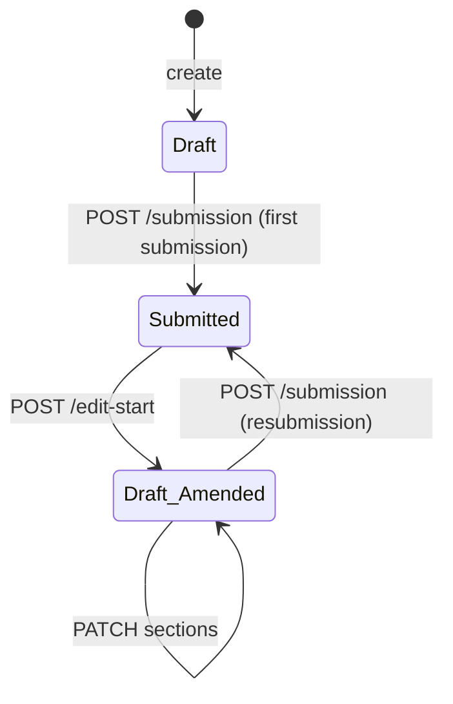

# Submitting, amending and resubmitting a Catch Record

End-to-end guide to what happens when a Catch Record is submitted, how it is edited afterwards (amended)
and how it is submitted again. It consolidates, and does not replace, the per-step references:
[submission](./catch-recording-submission.md), [edit-start](./catch-recording-edit-start.md),
[amendment saves and resubmission](./catch-recording-amendment-saves-and-resubmission.md),
[submission artifacts](./catch-recording-submission-artifacts.md) and
[lifecycle policies](./catch-recording-lifecycle.md).

## Summary



- Only three statuses are stored: `DRAFT`, `SUBMITTED`, `COMPLETE`. **Amended is never stored**; it is the
  display status of `status = DRAFT` with `numberOfSubmissions > 0`.
- The record is amended **in place**. It is never cloned: `id`, `catchRecordReference`,
  `numberOfSubmissions`, `artifacts[]` and history all carry over.
- Every submission produces two immutable artifacts (a JSON snapshot and a PDF receipt) numbered by
  submission, so earlier submissions stay retrievable after any number of amendments.

| Step | Request                                  | Capability            | Source state           | Result state                           |
| ---- | ---------------------------------------- | --------------------- | ---------------------- | -------------------------------------- |
| 1    | `POST /v1/catch-records/{id}/submission` | `catch-record.submit` | `DRAFT`, 0 submissions | `SUBMITTED`, 1 submission              |
| 2    | `POST /v1/catch-records/{id}/edit-start` | `catch-record.amend`  | `SUBMITTED`            | `DRAFT`, `hasUnsubmittedChanges: true` |
| 3    | `PATCH /v1/catch-records/{id}` (repeat)  | `catch-record.update` | `DRAFT` (amended)      | `DRAFT`, still `hasUnsubmittedChanges` |
| 4    | `POST /v1/catch-records/{id}/submission` | `catch-record.submit` | `DRAFT`, ≥1 submission | `SUBMITTED`, count + 1                 |

All calls need a valid Entra bearer token and the capability above (see
[entra-authentication.md](./entra-authentication.md)); the capability check runs before validation and any
database access. All three mutating calls require an `If-Match` header carrying the record's current
`version` and accept an optional `Idempotency-Key`. The record must belong to the caller: another user's
record, or a missing one, returns the same `404 CATCH_RECORD_NOT_FOUND`.

## 1. What happens when a Catch Record is submitted

Entry point: `submitCatchRecord` in `src/catch-recording/controller/submit-catch-record.js`. The same code
serves first submission and resubmission; it decides which one it is from the stored record
(`canResubmit`: `DRAFT` with `numberOfSubmissions > 0`).

Sequence:

1. **Load** the record with an owner-scoped read. Not found: `404`.
2. **Idempotency** (only when `Idempotency-Key` was sent). The claim is scoped to `SUBMISSION` or
   `RESUBMISSION`. A repeat of an already-completed request replays the stored result. This is checked
   _before_ eligibility, because after a successful first attempt the record is no longer `DRAFT`. A
   request still being processed returns `409 IDEMPOTENCY_REQUEST_IN_PROGRESS`.
3. **Eligibility.** Only a never-submitted draft or an amended draft may be submitted. Anything else:
   `CATCH_RECORD_SUBMISSION_INELIGIBLE` (an `INVALID_LIFECYCLE_TRANSITION`).
4. **Complete validation** (`validateSubmissionReadiness`): structure and sections, vessel, every gear
   complete, and a fresh check of the vessel, ports, gears, statistical areas and species against the
   Reference Data Service. Failure: `SUBMISSION_VALIDATION_FAILED` with the issues in `details`; nothing is
   written.
5. **Submission number** = `numberOfSubmissions + 1`.
6. **Snapshot.** The complete record is frozen with `status: SUBMITTED`, the new submission number,
   `hasUnsubmittedChanges: false`, `submittedAt` (server clock) and `submittedBy` (the authenticated user).
   `artifacts` and `version` are excluded. If a JSON snapshot for this submission number already exists in
   storage (an earlier attempt died part-way), it is reused unchanged, so a retry is byte-identical.
7. **Artifacts** are written to object storage, JSON first and then PDF, at deterministic keys
   `catch-records/{id}/submissions/{n}/snapshot.json` and `.../receipt.pdf`. Existing identical objects are
   reused, never overwritten.
8. **Atomic commit** (`applySubmission`). One conditional update, guarded by `status = DRAFT` and the
   `If-Match` version, sets `status: SUBMITTED`, `numberOfSubmissions`, `hasUnsubmittedChanges: false`,
   `artifacts` (previous entries plus the two new ones), `submittedAt`, `submittedBy` and the audit fields,
   and increments `version`. If the guard fails, the reason is classified: record gone, `404`; record no longer a draft, ineligible; otherwise a stale `If-Match`, `VERSION_CONFLICT` (409).
9. **History** is appended (append-only): `SUBMITTED` for a first submission, `RESUBMITTED` for later ones,
   with `{ submissionNumber }`.
10. **Idempotency claim** is completed, when a key was supplied.

Failure behaviour: if artifact generation or storage fails before step 8, the record is untouched (no count
change, no history), and a retry resumes safely thanks to the deterministic keys and snapshot reuse. Because
storage and MongoDB are not one transaction, a crash between steps 7 and 8 can leave artifacts for a
submission that was never committed. They are reused by the retry.

Response (`200`): the standard save response (`id`, `catchRecordReference`, `status`, `displayStatus`,
`version`, `sectionCompletion`, `progress`) plus `submittedAt`, `submittedBy` and the cumulative `artifacts`
metadata. Use the returned `version` as the next `If-Match`.

State after a first submission: `status SUBMITTED`, `numberOfSubmissions 1`, `hasUnsubmittedChanges false`,
two artifacts, displayed as `Submitted`.

## 2. Starting an amendment (edit-start)

Entry point: `startCatchRecordEdit` in `src/catch-recording/controller/start-catch-record-edit.js`.
`POST /v1/catch-records/{id}/edit-start` has no body and takes no reason.

1. Owner-scoped load (`404` if missing or not owned).
2. Optional idempotency claim, scope `EDIT_START`, with replay as above.
3. Eligibility: `SUBMITTED` or only. A draft (new or already amended) returns
   `CATCH_RECORD_EDIT_START_INELIGIBLE`.
4. Atomic update (`applyEditStart`, guarded by the `If-Match` version): `status: DRAFT`,
   `hasUnsubmittedChanges: true`, audit fields, `version + 1`. Nothing else changes: `id`, reference,
   `numberOfSubmissions`, `artifacts[]`, `submittedAt/By` and any `completedAt/By` are preserved.
5. History event `EDIT_STARTED`.
6. Response: the standard save response. It now shows `displayStatus: Amended`.

## 3. Editing while amended

Edits use the normal section endpoint `PATCH /v1/catch-records/{id}` with `If-Match` and a body of
`{ "section": "<name>", "data": ... }` (`data` is an array for `gears` and `speciesNotLanded`, an object for
other sections). No separate amendment endpoint exists.

- The update is applied only while `status = DRAFT`. Patching a `SUBMITTED` or record is rejected
  (`CATCH_RECORD_SECTION_UPDATE_INELIGIBLE`), so edit-start is mandatory first.
- Each save increments `version`; send the latest `version` as the next `If-Match`. A stale value is a
  `VERSION_CONFLICT` (`409`).
- History is `AMENDMENT_SECTION_SAVED` for an amended draft (`SECTION_SAVED` for a never-submitted one).
- `hasUnsubmittedChanges` stays `true`, and `artifacts[]` and the previous submissions are never touched.
- The previous submission remains the official evidence until the amended record is submitted. Its
  artifacts stay downloadable (`GET .../submissions` and `GET .../submissions/{n}/{json|pdf}`).

## 4. Submitting again (resubmission)

`POST /v1/catch-records/{id}/submission` again, with the latest `If-Match`. It runs the exact sequence in
section 1, with these differences:

- Eligibility uses the amended-draft rule; idempotency scope is `RESUBMISSION`.
- Validation is complete and reference data is re-checked, so an amended record can be rejected even if the
  first submission was accepted.
- The submission number is the next one (for example 2), so new artifacts are written under
  `submissions/2/` and **add to** the earlier ones. Submission 1 is never overwritten.
- The commit sets `status: SUBMITTED`, increments `numberOfSubmissions` exactly once, sets
  `hasUnsubmittedChanges: false`, refreshes `submittedAt` and `submittedBy` to the resubmission, and keeps
  all earlier artifact entries.
- History is `RESUBMITTED`.

The record is back in `SUBMITTED` and can be amended again, repeating steps 2 to 4 indefinitely.

## Example sequence

```text
POST   /v1/catch-records/{id}/submission   If-Match: 5   -> 200 SUBMITTED, version 6, 1 submission, 2 artifacts
POST   /v1/catch-records/{id}/edit-start   If-Match: 6   -> 200 DRAFT (Amended), version 7
PATCH  /v1/catch-records/{id}              If-Match: 7   -> 200 version 8   { "section": "trip", "data": { ... } }
POST   /v1/catch-records/{id}/submission   If-Match: 8   -> 200 SUBMITTED, version 9, 2 submissions, 4 artifacts
GET    /v1/catch-records/{id}/submissions                -> submissions 1 and 2, each with json and pdf
```

## Error reference

| Situation                                    | Code                                     | Notes                                                    |
| -------------------------------------------- | ---------------------------------------- | -------------------------------------------------------- |
| Missing or foreign record                    | `CATCH_RECORD_NOT_FOUND` (404)           | Masked to prevent enumeration                            |
| Stale `If-Match` version                     | `VERSION_CONFLICT` (409)                 | Re-read the record and retry with its version            |
| Submit from `SUBMITTED`                      | `CATCH_RECORD_SUBMISSION_INELIGIBLE`     | Start an edit first                                      |
| Edit-start from a draft                      | `CATCH_RECORD_EDIT_START_INELIGIBLE`     |                                                          |
| PATCH on a non-draft                         | `CATCH_RECORD_SECTION_UPDATE_INELIGIBLE` | Call edit-start first                                    |
| Record incomplete or invalid at submission   | `SUBMISSION_VALIDATION_FAILED`           | `details` lists the issues                               |
| Same idempotency key still in progress       | `IDEMPOTENCY_REQUEST_IN_PROGRESS` (409)  | Retry later                                              |
| Missing, invalid or unauthorised credentials | 401, 403 or 503                          | See [entra-authentication.md](./entra-authentication.md) |

## Source files

| Area                        | File                                                                 |
| --------------------------- | -------------------------------------------------------------------- |
| Routes and capabilities     | `src/routes/catch-records.js`                                        |
| Submission and resubmission | `src/catch-recording/controller/submit-catch-record.js`              |
| Edit-start                  | `src/catch-recording/controller/start-catch-record-edit.js`          |
| Amendment saves             | `src/catch-recording/controller/save-catch-record-section.js`        |
| Lifecycle rules             | `src/catch-recording/domain/lifecycle-transitions.js`                |
| Readiness validation        | `src/catch-recording/validation/submission-readiness.js`             |
| Atomic persistence          | `src/catch-recording/persistence/catch-persistence-lifecycle.js`     |
| Artifact keys and storage   | `src/catch-recording/artifact/artifact-keys.js`, `catch-artifact.js` |
