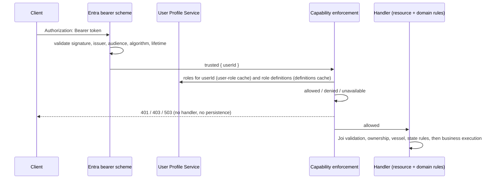

# Entra External ID authentication and authorization

> Implements the approved design in `design/architecture/final-entra-external-id-authentication-and-authorization-design.md`.
> The document has one section per implementation step and states what is implemented **now**. The legacy
> Authentication Service flow was removed (see [Legacy authentication removal](#legacy-authentication-removal-step-14));
> [`catch-recording-authentication.md`](./catch-recording-authentication.md) is only a pointer. Configuration
> names are listed in [`configuration-decisions.md`](./configuration-decisions.md) and `.env.sample`. For
> operations, start with the [conformance review and readiness](#architecture-conformance-and-operational-readiness-step-16)
> section at the end.

## OIDC metadata and signing keys (Step 02)

Entra signs access tokens; this service verifies them locally with Entra's public keys. Step 02 only
obtains and caches those keys — **no bearer token is validated yet**.

Code: `src/authentication/entra/` and the `entraSigningKeys` plugin (`src/plugins/entra-signing-keys.js`),
which decorates the server with `server.entraSigningKeyProvider` (`null` when Entra is not configured,
which is only permitted for local development).

| File                      | Responsibility                                                                                                                                                           |
| ------------------------- | ------------------------------------------------------------------------------------------------------------------------------------------------------------------------ |
| `bounded-json-fetch.js`   | One GET with a bounded timeout and body size; redirects are never followed; every failure is mapped to a safe `SigningKeyError`.                                         |
| `oidc-metadata-client.js` | Reads the discovery document from the configured `entra.oidcMetadataUrl` only; requires the `issuer` to equal `entra.issuer` exactly.                                    |
| `jwks-client.js`          | Reads the JWKS from the validated `jwks_uri` only and builds verification keys with `jose` (no hand-written cryptography).                                               |
| `signing-key-provider.js` | Immutable snapshot, exact-`kid` lookup, single-flight throttled refresh, atomic replacement.                                                                             |
| `signing-key-failure.js`  | Typed, HTTP-independent failure reasons (metadata/JWKS unavailable or invalid, issuer mismatch, no usable keys, key not found, throttled, timeout, cancelled, internal). |

Behaviour:

- **Trust boundary.** The JWKS URL comes only from successfully validated metadata fetched from the
  configured URL — never from a token, claim or header. It must be `https` (an `http` `jwks_uri` is accepted
  only for local development).
- **Accepted keys.** RSA public keys with a unique, non-empty `kid`, `use` `sig` (or absent), an allowed
  `alg` (or absent), `verify` key operations (or absent), a plausible exponent and a modulus of at least
  2048 bits, and no private members. Anything else is ignored and never used as a fallback; a duplicate
  `kid`, an oversized or malformed document is rejected whole. A response yielding no usable key never
  replaces the current snapshot. Limits: 64 KiB metadata, 256 KiB JWKS, 20 keys.
- **Lazy load.** Nothing is fetched at startup, so `/health` and public routes never depend on Entra.
- **Refresh.** A snapshot older than `entra.metadataRefreshIntervalSeconds` is refreshed on the next lookup.
  An unknown `kid` triggers exactly one refresh followed by exactly one retry of the same lookup. Attempts
  are at least `entra.minimumRefreshIntervalSeconds` apart (a throttled lookup returns `REFRESH_THROTTLED`,
  so repeated unknown `kid` values cannot cause a refresh storm), and concurrent callers share the one
  in-flight refresh. A cancelled caller stops waiting without cancelling the shared refresh.
- **Failure.** A failed or invalid refresh keeps the previous valid snapshot and never extends its due
  time, so the next lookup after the minimum interval tries again. With no snapshot, every lookup returns
  the failure reason.
- **Atomicity.** A candidate snapshot is fully built and validated before it replaces the active one.
- **Privacy.** Failures carry fixed reasons only: no URL, response body, header, key material or token is
  logged or exposed.
- **Dependency.** `jose` (named in the approved design §8.3) is the only added dependency.

Deferred: bearer-token validation (Step 03), the authenticated-user context (Step 04) and mapping of the
failure reasons to `401`/`503` (Step 12).

## Bearer access-token validation (Step 03)

Code: `src/authentication/entra/` (`bearer-token.js`, `access-token-validator.js`,
`entra-authentication-scheme.js`) and the `entraAuthentication` plugin
(`src/plugins/entra-authentication.js`), which registers the Hapi strategy `entra-bearer`.

- **Where the token comes from.** Only the standard `Authorization: Bearer <token>` header. A missing,
  empty, repeated, malformed or non-Bearer header is rejected; the credential is read byte-for-byte and
  is never taken from a query string, body, cookie or custom header.
- **Validation is local**, with `jose` (no hand-written cryptography). Before any key lookup only the
  protected header's `alg` (must be in `entra.allowedAlgorithms`, so `none`, symmetric and other
  algorithms are rejected) and non-empty `kid` are read. The key comes **only** from the Step 02 signing
  key provider; `jku`, `x5u` and other token-supplied key locations are ignored and no fallback key is
  ever chosen.
- **Enforced.** Signature, exact `iss` (`entra.issuer`), exact `aud` (`entra.audience`; a multi-valued
  `aud` passes only if it contains that value), `exp` (required), `nbf` (when present). Substring,
  case-folded, wildcard and alias matches are rejected. A token for another API, an ID token or one for
  another environment fails on audience/issuer.
- **Clock skew** is explicit and strict: `0` seconds (the validator accepts an injectable tolerance and
  clock). Entra does not currently define a tolerance for this service; see the open items below.
- **Token version.** The approved design does not prescribe a `ver` check, so none is invented; the exact
  issuer (which carries the `/v2.0` path for v2 tokens) is the version binding.
- **Result.** Success returns a deep-frozen claims object only after every check passes; failure returns
  `{ ok: false, reason, source }` where `source` is `credentials`, `dependency` (signing keys
  unavailable, or Entra not configured) or `internal`. Neither contains the token or any claim.
- **Claim isolation.** Claims are never attached to the request. The `entra-bearer` strategy
  authenticates with an empty credentials object: no user identity exists until the trusted
  authenticated-user context is added (Step 04). A failure stops the request with the existing generic
  `401 AUTHENTICATION_REQUIRED`; the reason stays in the internal `cause`.
- **Not logged.** Tokens, headers and claim sets are never logged by this code.
- **Shared state.** One validator per server reuses the shared provider; the validator holds no
  per-request state.
- **Dormant.** No route uses `entra-bearer` yet and the legacy `authentication-service` strategy is
  untouched; fixed mock-token removal is Step 14. When Entra is not configured (local only) every token is
  rejected - there is no fallback.

Deferred: user identity (Step 04), `503` for key-dependency failures and the final `401` challenge
(Step 12), telemetry (Step 13).

Open item for the Identity/DevOps owners: confirm whether a bounded clock tolerance is required.

## Trusted authenticated-user context (Step 04)

Code: `src/authentication/entra/authenticated-user-context.js`; wired into the `entra-bearer` strategy
(`entra-authentication-scheme.js`).

Request pipeline: read the bearer credential, validate the token completely (Step 03), extract the single
configured identity claim, create the context, and only then continue. A failure at any stage stops the
request with the generic `401 AUTHENTICATION_REQUIRED`; a failed request has no context.

- **One claim, no fallback.** Exactly `entra.userIdClaim` is read (own property of the validated claims
  only). `oid`, `sub`, `email`, `preferred_username` and similar are never substituted or combined.
- **Rejected:** missing, `null`, non-string (number, boolean, object), array (including single-element
  and multi-valued), empty, whitespace-only, padded, over-long (more than 128 characters) or containing
  anything outside `A-Z a-z 0-9 . _ ~ -` (so no control characters, spaces, path separators or percent
  escapes can reach the User Profile Service URL).
- **Opaque identifier.** The approved design leaves the claim configurable (`oid` is a GUID, `sub` is an
  opaque string) and the mock User Profile Service uses non-GUID identifiers, so no GUID constraint is
  imposed and the value is preserved exactly (no case folding). Assumption recorded; confirm the final
  claim with the Identity/DevOps owners.
- **Context.** `Object.freeze({ userId })` - no token, claims, roles, scopes, capabilities, e-mail, name
  or profile data. It is the request's Hapi credentials, so it is request-scoped (no module-level
  "current user"); concurrent requests cannot observe each other's identity.
- **Accessor.** Downstream code calls `getAuthenticatedUser(request)`. It returns the context only for a
  request authenticated by `entra-bearer` with a context created by this module, and `null` otherwise -
  so a legacy `authentication-service` principal, or any look-alike object, never satisfies it. It never
  reads a body, query, route parameter, header or cookie, so request data cannot override the caller.
- **Transition.** The legacy strategy is unchanged and no route uses `entra-bearer` yet; there is no
  fallback from a failed Entra authentication to a mock identity. Step 05 will use `userId` to build the
  user-roles request; roles, caching and capabilities are not part of this step.

## User Profile Service client (Step 05)

Code: `src/authorization/user-profile-client.js`; registered once by the `userProfile` plugin
(`src/plugins/user-profile-client.js`) as `server.userProfileClient` (`null` only when authorization is
entirely unconfigured in local development). It is not yet used by any request path.

It supports exactly two reads and nothing else (no arbitrary-path client):

| Operation                  | Request                      | Source of the variable part                                                      |
| -------------------------- | ---------------------------- | -------------------------------------------------------------------------------- |
| `getUserRoles(user, opts)` | `GET {userRolesUrlTemplate}` | `user.userId` from the trusted Step 04 context, as one encoded path segment      |
| `getRoleDefinitions(opts)` | `GET {roleDefinitionsUrl}`   | the validated configuration (its path already carries `authorization.serviceId`) |

- **Trusted identity only.** `getUserRoles` accepts only a context created by Step 04; any other value
  (including a look-alike object or a string) is refused before a request is built. Path, query, body and
  header values can never replace the origin or the identifier.
- **No credentials.** Only `Accept: application/json` and the correlation header are sent. The incoming
  Entra access token is never forwarded; there is no API key, secret, managed identity, mTLS or signed
  request. The current User Profile Service is an unauthenticated mock; **production service-to-service
  authentication remains a deferred production requirement**.
- **Correlation.** The caller-supplied correlation id is sent in the configured tracing header
  (`tracing.header`, `x-cdp-request-id`) only if it is a safe token (1-128 of `A-Za-z0-9._-`).
- **Timeout / cancellation.** `authorization.userProfileRequestTimeoutMs` bounds every attempt; a caller
  `AbortSignal` is honoured independently, so `TIMEOUT` and `CANCELLED` are distinct outcomes.
- **Retry.** The repository's existing approved policy: only HTTP `502`/`503`/`504`, at most
  `authorization.userProfileRetryCount` retries, `authorization.userProfileRetryDelayMs` apart. Timeouts,
  other statuses and invalid content are never retried, so total time stays bounded.
- **Response handling.** `200` with a JSON content type and a body of at most 256 KiB yields
  `{ ok: true, body }` where `body` is the parsed, deeply frozen, **untrusted** JSON. Otherwise
  `{ ok: false, outcome, status }` with one of `NOT_FOUND`, `CLIENT_ERROR`, `RATE_LIMITED`,
  `SERVER_ERROR`, `UNAVAILABLE`, `UNEXPECTED_STATUS`, `UNEXPECTED_CONTENT_TYPE`, `INVALID_JSON`,
  `TIMEOUT`, `CANCELLED`, `TRANSPORT_FAILURE`, `INTERNAL_ERROR`. These are transport facts, not
  authorisation decisions (a `404` is not a `403`; nothing grants access) and are not mapped to HTTP
  statuses here. Redirects are never followed.
- **Logging.** Safe fields only (operation, outcome, status, duration, attempt). No user identifier, URL,
  body, role or token is logged.
- **Not done here:** semantic validation of the bodies (Step 06), caching (Steps 07-08), capability
  decisions (Step 09).

## Authorization response validation (Step 06)

Code: `src/authorization/authorization-response-validator.js`. It turns an untrusted Step 05 transport
result into an immutable internal model, or a typed failure. Nothing is cached, retried or decided here.

- `validateUserRolesResult(transportResult, trustedUser)` -> `{ userId, definitionsVersion, roleIds }`
- `validateRoleDefinitionsResult(transportResult, serviceId)` -> `{ serviceId, definitionsVersion,
updatedAt, roles: [{ roleId, capabilityIds }] }`

Results are `{ ok: true, value }`, `{ ok: false, source: 'dependency', outcome, status }` (a Step 05
transport failure, passed through untouched - validation never pretends to have happened) or
`{ ok: false, source: 'validation', reason }`. A model exists only after complete validation, is deeply
frozen, and copies nothing from the transport object (extra fields are ignored, not retained).

Validated (the first problem rejects the whole response; nothing is coerced, trimmed, de-duplicated or
silently dropped):

- `schemaVersion`: string, exactly in the allow-list `['1.0']` (no newer or numeric version).
- User roles: `userId` must equal the trusted requested identifier exactly (case-sensitive); `roles` is a
  unique array of valid identifiers. A response for another user is rejected.
- Role definitions: `serviceId` must equal the configured `authorization.serviceId`; `roles` is a
  non-empty array of `{ roleId, capabilityIds }` with unique role ids and unique capability ids per role.
- `definitionsVersion`: required string, up to 64 characters of `A-Za-z0-9._-`, starting alphanumeric.
- `updatedAt`: optional; when present a strict UTC instant (`...Z`, real calendar date), normalised to ISO.
  It is metadata only and is never used for local cache timing.
- Identifiers (roles, capabilities): up to 128 characters of `A-Za-z0-9._:-`, starting alphanumeric - this
  accepts values such as `VRO5--Owner` and `catch-record.read` while rejecting whitespace, control
  characters, separators and wildcards. The capability catalogue is not hard-coded here.
- Bounds: 1000 user roles, 200 role definitions, 100 capabilities per role, 2000 role-capability
  associations in total.

Decisions recorded:

- **Unknown user / no roles.** The approved contract returns `200` with `roles: []` for an unknown user, so
  that is a valid outcome with an empty `roleIds` (no default role, never unrestricted). A transport
  `404` is **not** treated as an unknown user: it stays a dependency failure.
- **Empty role definitions.** Design 7.3 says an empty set grants nothing; design 8.8 says an unexpectedly
  empty body must never replace a valid cache. The conservative reconciliation: an empty `roles`
  collection is rejected as `EMPTY_ROLE_DEFINITIONS` (never usable), so it can neither replace a snapshot
  nor be mistaken for allow-all. A role with an empty `capabilityIds` list is valid and grants nothing.
- Limits are conservative initial values (the design defines none); user roles are bounded generously
  because they can be vessel-scoped.

Open item for Step 09: the design's examples show assigned roles such as `VRO5--Owner` while definitions
list `Owner`; how an assigned role id is matched to a definition is a Step 09 concern and is resolved there.

## User-role cache (Step 07)

Code: `src/authorization/user-role-cache.js`; registered once by the `userRoleCache` plugin
(`src/plugins/user-role-cache.js`) as `server.userRoleCache` (`null` only when authorization is unconfigured
in local development; cleared on server stop). It is not yet used by any request path.

`getUserRoles(user, { correlationId, signal })` returns `{ ok: true, value, cacheState: 'hit' | 'refreshed' }`
or the typed failure of the stage that failed: `{ source: 'dependency' }` (Step 05), `{ source:
'validation' }` (Step 06) or `{ source: 'cache', reason }` (an untrusted user context or an unexpected
error). Failures are never cached and never become an empty role set.

- **Key and value.** Keyed only by the trusted stable user identifier. A cache entry holds only the Step
  06 validated, frozen model (`userId`, `roleIds`, `definitionsVersion`) plus local load and expiry times.
  No token, claim, DTO, JSON, header, response object, capability or role definition is stored.
- **TTL.** `expiresAt` = successful refresh time + `authorization.userRoleCacheTtlSeconds` (initially
  `300`), measured on a monotonic clock. **Fresh while `now < expiresAt`; expired from `now >= expiresAt`.**
  A role removal therefore takes effect no later than the TTL after the last successful retrieval (plus any
  request already in progress).
- **No stale use.** An expired entry is never returned - not even when the refresh fails - and a failed
  refresh never extends it. There is no maximum-stale period for user roles (that belongs to role
  definitions, Step 08). Refresh failure with no usable entry is returned as a failure; Step 12 will map it.
- **No-role users.** A valid response with no roles (how the contract represents an unknown user) is
  cached for the normal TTL and yields an empty `roleIds`, never a default role.
- **Single-flight.** Concurrent lookups for one user share one refresh; different users refresh
  independently and no lock is held across I/O. A caller that cancels stops waiting without cancelling the
  shared refresh. Coordination state is released on success, failure and exception and is bounded by the
  number of in-flight users.
- **Atomic publication and ordering.** A complete validated entry replaces the previous one in a single
  operation; an older refresh result never replaces a newer entry.
- **Capacity.** At most `authorization.userRoleCacheMaximumEntries` users. When full, expired entries are
  removed first, then the least recently used entry (a hit counts as use). No per-entry timers or
  background scanning.
- **Process-local.** Each instance has its own cache, so roles may differ between instances for up to the
  TTL, and a restart empties it. There is no distributed cache.
- **Logging.** Debug events (hit, miss, expired, refresh started/succeeded/failed/coalesced, inserted,
  replaced, evicted, capacity reached) carry no user identifier, role, token or response body; metrics are
  part of Step 13.

## Role-definition cache (Step 08)

Code: `src/authorization/role-definitions-cache.js`; registered once by the `roleDefinitionsCache` plugin
(`src/plugins/role-definitions-cache.js`) as `server.roleDefinitionsCache` (`null` only when authorization
is unconfigured in local development; cleared on server stop). It is a separate cache from the user-role
cache and is not yet used by any request path.

It holds **one** immutable snapshot for `authorization.serviceId`: the Step 06 validated definitions plus
local timing. No user, token, user-role assignment, DTO, JSON or HTTP object is stored, and no
caller-supplied service identifier is accepted.

Timing is local and monotonic, measured from the successful load (`downstream updatedAt` is metadata only):

```text
freshUntil        = loadedAt + authorization.roleDefinitionsCacheTtlSeconds
maximumStaleUntil = freshUntil + authorization.roleDefinitionsCacheMaximumStaleSeconds   (additional window)

fresh       now <  freshUntil
stale       freshUntil <= now < maximumStaleUntil
over-stale  now >= maximumStaleUntil   (never usable)
```

`getRoleDefinitions({ correlationId, signal })`:

| Held snapshot | Behaviour                                                                                                                                                             |
| ------------- | --------------------------------------------------------------------------------------------------------------------------------------------------------------------- |
| absent        | single-flight load; success -> `loaded`; failure -> `{ ok: false, snapshotState: 'absent' }`                                                                          |
| fresh         | returned without a request (`hit`); reading never extends a lifetime                                                                                                  |
| stale         | refresh; success -> `refreshed`; failure -> the previous snapshot with `cacheState: 'stale-used'`, `freshness: 'stale'` and a safe `refreshFailure`, timing unchanged |
| over-stale    | refresh; success -> `refreshed`; failure -> `{ ok: false, snapshotState: 'over-stale' }` - the old snapshot is not returned                                           |

- Success is `{ ok: true, snapshot, freshness, cacheState }`; failures keep the Step 05/06 typed shape
  (`source: 'dependency' | 'validation' | 'cache'`) and are never turned into an empty or permissive map.
  The staleness of the previous snapshot is re-evaluated after the refresh returns, so a slow refresh can
  never yield a snapshot past its boundary.
- **Never replaced by bad data.** Dependency errors, invalid or mismatched content, an unsupported schema
  and empty definitions (rejected by Step 06) neither replace nor clear a valid snapshot. An older result
  never overwrites a newer snapshot; publication is one atomic assignment of a complete frozen snapshot.
- **Single-flight.** There is one service-level refresh shared by every concurrent caller (initial, stale
  and over-stale); a cancelled caller stops waiting without cancelling it; coordination state is always
  released so a failure never blocks a later attempt.
- **Startup.** After the server starts, one best-effort load is attempted through the same refresh
  operation; it is not awaited, never prevents startup and never blocks `/health`. If it fails, no snapshot
  exists and authorization stays unavailable until a lazy load succeeds (fail closed).
- **Refresh throttling.** No minimum-interval setting is approved for role definitions, so none is invented:
  single-flight bounds the dependency to one in-flight request, but during a User Profile Service outage
  each lookup that finds a stale or absent snapshot still starts the next attempt after the previous one
  ends. A refresh back-off/minimum interval is a recommended production follow-up (a new configuration
  decision).
- **Diagnostics.** `getStatus()` returns only `{ state, definitionsVersion }` (`absent`, `fresh`, `stale`,
  `over-stale`) for later health reporting; the public `/health` is unchanged in this step.
- **Process-local.** Instances do not share snapshots; a restart empties the cache.
- **Logging.** Debug/warn events carry no role, capability, response body or user data; metrics are Step 13.

## Capability authorization engine (Step 09)

Code: `src/authorization/capability-authorizer.js`; registered once by the `capabilityAuthorizer` plugin
(`src/plugins/capability-authorizer.js`) as `server.capabilityAuthorizer` (`null` only when authorization is
unconfigured in local development). It is stateless and not yet applied to any endpoint (Step 10/11).

`authorize(user, requiredCapability, { correlationId, signal })` returns one frozen decision:

| `outcome`     | Meaning                                                               | `reason` values                                                                                                                                                                                                                        |
| ------------- | --------------------------------------------------------------------- | -------------------------------------------------------------------------------------------------------------------------------------------------------------------------------------------------------------------------------------- |
| `allowed`     | at least one known assigned role grants the exact capability          | - (carries `capability`, `definitionsVersion`, cache states, `staleDefinitionsUsed`, `unknownRoleCount`)                                                                                                                               |
| `denied`      | data was available and nothing grants it                              | `NO_ASSIGNED_ROLES`, `ALL_ASSIGNED_ROLES_UNKNOWN`, `CAPABILITY_NOT_GRANTED`, `REQUIRED_CAPABILITY_UNKNOWN`                                                                                                                             |
| `unavailable` | authorization could not be evaluated (never a denial, never an allow) | `UNTRUSTED_USER_CONTEXT`, `INVALID_REQUIRED_CAPABILITY`, `USER_ROLES_UNAVAILABLE`, `ROLE_DEFINITIONS_UNAVAILABLE`, `ROLE_DEFINITIONS_OVER_STALE`, `AUTHORIZATION_DATA_INVALID`, `CANCELLED`, `INTERNAL_FAILURE` (with a safe `detail`) |

The engine maps nothing to HTTP (Step 12 maps `denied` -> `403` and `unavailable` -> `503`).

Deterministic order: trusted user context and required capability valid -> current user roles (Step 07)
-> empty roles (unknown user or no roles) denied **without** loading definitions -> usable definitions
(Step 08) -> capability absent from every definition denied -> any known assigned role grants -> allowed.

- **Any-role-grants, exact matching.** Roles and capabilities are compared as exact strings: no prefix,
  suffix, substring, wildcard, regex, case, trim, alias, hierarchy or inheritance behaviour. `catch-record.read`
  never implies another capability and a wildcard-looking identifier grants nothing beyond itself.
- **Unknown roles grant nothing** and are not dependency failures; they never block a grant from a known
  role (only a count is kept for diagnostics). An unknown required capability is denied, never
  unavailable.
- **Trust.** Roles come only from the Step 07 result, definitions only from Step 08; the engine never
  recalculates TTL or maximum stale, never refreshes independently, and never reads token roles, groups
  or scopes. Permitted stale definitions are usable and marked (`staleDefinitionsUsed`). Expired user roles
  and over-stale definitions arrive as failures and are `unavailable`.
- **Required capability type.** `createRequiredCapability(id)` returns a frozen value (exact, valid
  identifier required); only values it issued are accepted, so a role id or arbitrary string cannot be used
  by mistake. The capability catalogue and endpoint mappings are Step 10.
- **Fail closed.** An unexpected exception, an untrusted user context or a non-issued capability yields
  `unavailable`; nothing defaults to allow.
- **Logging.** One `authorization.decision` entry (outcome, reason, capability, definitions version, cache
  states, correlation id); never the user identifier, role list or capability map.

Open item to confirm before production: the design's examples show assigned roles such as `VRO5--Owner`
alongside definitions named `Owner`. The approved rule (design 8.9) is an exact lookup of each assigned role
id in the definitions, and no name inference or alias handling is added, so assigned role ids must equal
definition `roleId`s.

## Endpoint-to-capability mapping (Step 10)

Code: `src/authorization/capabilities.js` (catalogue), `protected-route.js` (`protectedRoute`),
`authorization-errors.js`, and the `capabilityEnforcement` plugin (`src/plugins/capability-enforcement.js`).

**Catalogue** - exactly five exact, case-sensitive capabilities, created once with `createRequiredCapability`:
`catch-record.read`, `catch-record.create`, `catch-record.update`, `catch-record.submit`, `catch-record.amend`.
No aliases, wildcards or role-named capabilities. Grants are owned by the User Profile Service role
definitions; this service hard-codes no role-to-capability grant.

**Role form and vessel scope.** Assigned roles have the form `[vessel]--[role]` (for example `VRO5--Owner`).
`parseVesselScopedRole` splits on exactly one `--`; the role part is looked up in the definitions and its
capabilities apply to that vessel only. A role not of that form is unrecognised and grants nothing. The
engine accepts an optional `vesselId` (only a role assigned for that exact vessel counts) and an allowed
decision lists `grantedVesselIds`.

**Mechanism.** A route declares `...protectedRoute({ capability, vesselIdParam? })`, which sets the Entra
`entra-bearer` strategy and route metadata. The `capabilityEnforcement` plugin runs once at `onPostAuth` -
after authentication, before payload validation and the handler - so a denied or unavailable decision stops
the request before any protected side effect. The caller is only the trusted authenticated-user context; the
capability comes only from route metadata, never request data.

| Operation                    | Route(s)                                                                                                                      | Capability                            |
| ---------------------------- | ----------------------------------------------------------------------------------------------------------------------------- | ------------------------------------- |
| Read                         | `GET /v1/catch-records`, `GET .../{id}`, `GET .../{id}/history`, `GET .../{id}/submissions`, `GET .../submissions/{n}/{type}` | `catch-record.read`                   |
| Create                       | `POST /v1/catch-records`                                                                                                      | `catch-record.create`                 |
| Update / save and continue   | `PUT`, `PATCH`, `DELETE` (abandon draft) `/v1/catch-records/{id}`                                                             | `catch-record.update`                 |
| Submit                       | `POST .../{id}/submission`                                                                                                    | `catch-record.submit`                 |
| Amend                        | `POST .../{id}/edit-start`                                                                                                    | `catch-record.amend`                  |
| Vessel favourites / skippers | `GET /v1/vessels/{vesselId}/favourite-*`, `.../skippers`                                                                      | `catch-record.read` for that vessel   |
|                              | `POST`/`DELETE` on the same                                                                                                   | `catch-record.update` for that vessel |

Mapping notes: abandon is mapped to `update` because it is the only approved capability that fits an
operation on an editable draft (a mapping by elimination, no capability was invented); amendment saves reuse
`PATCH` and so need `update`, resubmission reuses the submission route and needs `submit`.

**Fail closed.** The server refuses to start, and each request fails closed with `500`, for any authenticated
route without a catalogue capability, with a different strategy, or whose `vesselIdParam` is not in its path.
Public routes (`auth: false`/default) are untouched. An unconfigured authorizer yields `503`. A capability
unknown to the current role definitions is denied by the engine.

**Outcomes (existing categories, no new ones).** Denied -> `403 ACCESS_DENIED`; authorization data
unavailable -> `503 DEPENDENCY_UNAVAILABLE`; internal wiring failure -> `500`. The reason is kept in the
error's internal `meta` only. Final public response shaping and the `WWW-Authenticate` challenge are Step 12.

**Resource and domain checks are unchanged** (ownership, vessel access, lifecycle, versions) and remain in the
handlers; Step 11 composes them explicitly. The legacy `authentication-service` strategy remains registered
but no route uses it; its removal is Step 14.

**Completion removed.** `POST /v1/catch-records/{id}/completion` was deprecated and removed on the product
owner's instruction (route, controller, scope-based `completion-policy.js`, OpenAPI path and docs). The
`applyCompletion`/`findCatchRecordById` persistence primitives remain with no caller.

**Vessel routes.** Vessel favourites and skippers were mapped to read/update because assigned roles are
vessel-scoped (`[vessel]--[role]`), on the product owner's guidance; confirm this is the intended
semantics before production.

## Composition of capability, resource and domain authorization (Step 11)

A protected operation runs only when **all** layers succeed:

```text
authenticated (Step 03/04)  AND  capability granted (Step 09/10)  AND  resource access  AND  domain rules  ->  execute
```

| Layer            | Where it runs                                           | Authoritative component                                                                                                                            |
| ---------------- | ------------------------------------------------------- | -------------------------------------------------------------------------------------------------------------------------------------------------- |
| Authentication   | Hapi auth (`entra-bearer`)                              | Step 03/04                                                                                                                                         |
| Capability       | `onPostAuth`, before payload validation and the handler | `capabilityEnforcement` -> Step 09 engine, capability from route metadata                                                                          |
| Input validation | Hapi route `validate` (after capability)                | existing Joi schemas                                                                                                                               |
| Resource access  | inside the controller, as part of the lookup            | owner-scoped persistence predicates (`ownerUserId` in the query), the vessel-access policy for vessel profiles and draft creation (Reference Data) |
| Domain rules     | inside the controller, after resource lookup            | existing lifecycle / completeness / transition rules                                                                                               |
| Execution        | persistence writes                                      | only after the layers above                                                                                                                        |

Because the capability check is a single `onPostAuth` boundary that applies to every authenticated route
(and the server refuses to start otherwise), no handler, controller, repository or reference-data call runs
after a denied or unavailable decision, and a failed authentication never reaches it. The composition is
tested in `src/routes/authorization-composition.test.js` (every protected route stops on denial,
unavailability and internal failure with no collection access, no write and no reference-data call; an
allowed capability does not bypass the owner-scoped lookup, which still returns the masked `404` with no
write; invalid input is rejected only after the capability is granted; ownership never replaces the
capability), alongside the existing route tests for the domain rules (`409`/`422`) behind an allowed
capability.

- **Capability does not replace resource access.** `read`, `update`, `submit` and `amend` never grant
  access to another owner's record: lookups are scoped to the trusted `userId`, and a record that is not the
  caller's remains a masked `404` (resource-existence masking is preserved and is not revealed by the
  capability layer).
- **Resource access does not replace the capability.** Ownership, vessel association and prior submission
  never substitute for the capability (submit needs `catch-record.submit`, amend `catch-record.amend`;
  `update` alone reaches neither).
- **Create.** `catch-record.create` is checked before any reference-data call or record creation; the
  existing vessel-access rule then applies and only then is the empty `DRAFT` created.
- **Side effects.** All mutations (record writes, history, idempotency claims, artifacts, favourite and
  skipper updates) happen in controllers after the capability gate; no event or audit success is emitted
  before it.
- **Distinct internal outcomes** are preserved (`denied`, `unavailable`, resource `404`, domain `409`/`422`,
  validation `400`); public response shaping is finalised in Step 12.
- **Bypasses closed.** There is one route table; every authenticated route must be `protectedRoute`-declared
  or the server does not start; the removed completion route no longer exists; there are no internal or
  scheduled callers of these use cases.

Open items (not changed here because the step forbids new ownership or vessel rules):

- Vessel scope is enforced for the vessel routes (`/v1/vessels/{vesselId}/...`) from the path. For
  operations on a catch record, or draft creation (vessel in the payload), the capability is granted if a role
  grants it for **any** vessel and the existing owner / reference-data vessel-access rules decide the rest.
  Requiring the capability for the record's or payload's specific vessel would be a new vessel rule and needs
  a product decision (`grantedVesselIds` is already available through `getCapabilityDecision(request)`).
  Recommended before production.
- `GET /v1/catch-records` (listing) is capability- and owner-scoped but not vessel-filtered, for the same reason.

## Controlled HTTP outcomes (Step 12)

Authentication and authorization failures reuse the existing error contract
(`{ statusCode, code, message, correlationId? }`, produced by the central `error-mapping` boundary); no new
format, category or header scheme is introduced. The detailed reason is never public.

| Public status | Code                      | Meaning                                                                                        | Internal outcomes                                                                                                                                                                                                                                                                |
| ------------- | ------------------------- | ---------------------------------------------------------------------------------------------- | -------------------------------------------------------------------------------------------------------------------------------------------------------------------------------------------------------------------------------------------------------------------------------- |
| `401`         | `AUTHENTICATION_REQUIRED` | Authentication is required or the credentials are invalid. Carries `WWW-Authenticate: Bearer`. | missing, empty or malformed header, unsupported scheme, malformed JWT, disallowed algorithm, missing or invalid `kid`, unknown signing key, bad signature, wrong issuer or audience, expired, not yet valid, missing or malformed identity claim, signing-key source unavailable |
| `403`         | `ACCESS_DENIED`           | Authenticated, but not permitted. One indistinguishable response.                              | unknown user, no roles, capability not granted, all assigned roles unknown, unknown capability, no role for that vessel                                                                                                                                                          |
| `503`         | `DEPENDENCY_UNAVAILABLE`  | Authorization information is temporarily unavailable. No challenge, no `Retry-After`.          | user-role data unavailable or invalid, role definitions absent, over-stale, unavailable or invalid, cancellation, authorizer unavailable                                                                                                                                         |
| `500`         | `INTERNAL_SERVER_ERROR`   | Unexpected defect or wiring failure (untrusted context, missing capability mapping).           | unchanged generic path                                                                                                                                                                                                                                                           |

```json
{
  "statusCode": 403,
  "code": "ACCESS_DENIED",
  "message": "You do not have permission to perform this operation.",
  "correlationId": "<trace id>"
}
```

- **Permission denial vs dependency failure.** A valid denial is `403`; authorization data that cannot be
  evaluated is `503` and never a `403` or `401`. Permitted stale role definitions are used normally (no
  public difference).
- **Signing-key outage.** The approved design does not distinguish an Entra metadata/JWKS outage publicly, so
  a token that cannot be validated because its signing key is unobtainable is the generic `401` (fail
  closed). This is a known trade-off: during an Entra metadata outage callers with a valid token whose key is
  not yet cached receive `401`. Monitoring (Step 13) must surface it.
- **Challenge.** Only `401` carries `WWW-Authenticate: Bearer` - no realm, `error` or `error_description` -
  so nothing about the failure is revealed. `403` and `503` carry none.
- **Correlation.** The existing correlation id (`x-cdp-request-id`, via `@defra/hapi-tracing`) is included in
  the body when present and in the safe log; it is never used as identity or permission evidence.
- **Cache-control.** Failures use the framework's existing `cache-control: no-cache`; no new header is
  invented.
- **Resource masking preserved.** Capability denial happens before any lookup, so it is `403` without
  probing existence; a record that is not the caller's remains the existing masked `404`.
- **Domain and input outcomes preserved.** `400`, `404`, `409`, `422` and `500` mappings are unchanged and are
  never reclassified as `403`/`503`.
- **Logging.** One `access-response` warning per `401`/`403`/`503` with only the bounded category, status,
  internal reason constant and correlation id - never tokens, headers, claims, identifiers, roles,
  capability maps or response bodies. Broader telemetry is Step 13.

## Security logging, metrics and correlation (Step 13)

Code: `src/authorization/security-telemetry.js` and the `securityTelemetry` plugin
(`src/plugins/security-telemetry.js`, registered right after `@defra/cdp-metrics`), plus
`src/common/helpers/logging/safe-log.js`. Every authentication and authorization component writes to one
sink, `server.securityTelemetry`, which is a drop-in structured logger that

1. keeps only an **allow-list of bounded, safe fields** (event, outcome, reason category, operation, status
   code, cache state, duration, correlation id, ...) - tokens, headers, claims, identifiers, roles,
   capability maps, URLs, response bodies, key ids and error objects are dropped before any log line or
   metric exists;
2. writes one structured line through the existing pino/ECS logger (the trace id is also added to every
   line by the existing logger mixin); and
3. counts the event, and records latency in milliseconds, through the existing `@defra/cdp-metrics`
   instance (`server.metrics`) with only enumerated dimensions.

Telemetry reports outcomes; it never decides them. Every log and metric call is guarded (`safeLog`, and
sink failures are swallowed), so an unavailable sink cannot fail a request, change an authentication or
authorization decision, or fail open.

### Correlation

The existing `x-cdp-request-id` (`@defra/hapi-tracing`) is the only correlation value. It appears in
structured logs and the public error body, is propagated unchanged to both User Profile Service calls
(including across a retry), and is **never** a metric dimension, cache key, identity or permission
evidence. Startup role-definition loading has no incoming request and is logged without a correlation id (a
request id is not faked).

### Events and metrics

Counters carry `Count`; latency metrics are milliseconds. Dimensions are the only labels used.

| Event (log `event`)             | Level                                                            | Counter                          | Latency (ms)               | Dimensions                                                                                                                                                                                                                               |
| ------------------------------- | ---------------------------------------------------------------- | -------------------------------- | -------------------------- | ---------------------------------------------------------------------------------------------------------------------------------------------------------------------------------------------------------------------------------------- |
| `auth.token-validation`         | debug success; info credential failure; warn key-source/internal | `authTokenValidations`           | `authTokenValidationMs`    | `outcome`, `reason` = `authenticated` \| `missing` \| `malformed` \| `algorithm` \| `key` \| `key-source` \| `signature` \| `issuer` \| `audience` \| `expired` \| `not-yet-valid` \| `identity-claim` \| `identity-claim-or-unexpected` |
| `oidc.refresh`                  | info success; warn failure                                       | `authSigningKeyRefreshes`        | `authSigningKeyRefreshMs`  | `outcome`, `reason` (a signing-key failure constant)                                                                                                                                                                                     |
| `oidc.lookup`                   | warn                                                             | `authSigningKeyLookups`          | -                          | `outcome` = `unknown-kid` \| `throttled`, `reason` (no raw `kid`)                                                                                                                                                                        |
| `user-profile.request`          | debug success; warn failure                                      | `authUserProfileRequests`        | `authUserProfileRequestMs` | `operation` = `user-roles` \| `role-definitions`, `outcome`                                                                                                                                                                              |
| `user-profile.retry`            | warn                                                             | `authUserProfileRetries`         | -                          | `operation`                                                                                                                                                                                                                              |
| `user-role-cache.*`             | debug (warn on failure)                                          | `authUserRoleCacheEvents`        | -                          | `result` = `hit` \| `miss` \| `expired` \| `refresh-started` \| `refresh-succeeded` \| `refresh-failed` \| `refresh-coalesced` \| `entry-inserted` \| `entry-replaced` \| `entry-evicted` \| `capacity-reached` \| `unexpected-error`    |
| `role-definitions-cache.*`      | debug (warn on failure)                                          | `authRoleDefinitionsCacheEvents` | -                          | `result` = the cache results above plus `load`, `stale`, `over-stale`, `stale-used`                                                                                                                                                      |
| `authorization.decision`        | debug allowed/denied; warn unavailable                           | `authDecisions`                  | `authDecisionMs`           | `outcome`, `reason` (`granted` or a denial/unavailable constant)                                                                                                                                                                         |
| `authorization.missing-mapping` | warn                                                             | `authMissingMappings`            | -                          | none                                                                                                                                                                                                                                     |
| `access-response`               | info 401/403; warn authorization-unavailable 503                 | `authHttpOutcomes`               | -                          | `statusCode`, `category`                                                                                                                                                                                                                 |

Log-only fields (never dimensions): `correlationId`, `capability` (always one of the five catalogue
values), `definitionsVersion`, `staleDefinitionsUsed`, `unknownRoleCount`, `keyCount`, `status`, `attempt`.
A new event or an unlisted cache result produces a log line but no metric.

Severity: expected `401`/`403` are never errors. Credential-level token failures log at info (below
warning, to limit flooding from repeated invalid tokens); aggregate counters are never suppressed. No
sampling framework exists in the repository and none was added.

### Recommended alerts (to be calibrated; no thresholds are defined or deployed)

Evaluate each over a rolling window against a baseline taken from production traffic and the service-level
objectives; none of these is configured by this repository.

1. Sustained increase in `authTokenValidations{outcome=failure}`, by `reason`.
2. Repeated `authSigningKeyRefreshes{outcome=failure}`, or any `reason=key-source` validation failures
   (an Entra metadata/JWKS outage surfaces to callers as `401`).
3. `authSigningKeyLookups{outcome=unknown-kid}` bursts.
4. `authUserProfileRequests` timeout/server-failure increase and `authUserProfileRetries` growth.
5. `authUserRoleCacheEvents{result=refresh-failed}` increase.
6. `authRoleDefinitionsCacheEvents{result=refresh-failed}`.
7. Any `authRoleDefinitionsCacheEvents{result=stale-used}` (running on stale definitions).
8. `authRoleDefinitionsCacheEvents{result=over-stale}` (maximum stale exhausted - authorization fails closed).
9. `authHttpOutcomes{statusCode=503}` increase.
10. Any `authMissingMappings` (a configuration defect).
11. `authDecisions{reason=INTERNAL_FAILURE}` and unexpected-error cache results.
12. A material drop in user-role cache hit rate (`hit` versus `miss`/`expired`).

### Health and tracing

- `/health` is unchanged and remains an unauthenticated, dependency-free liveness probe, so an Entra or User
  Profile Service outage cannot fail liveness. The role-definition cache exposes `getStatus()`
  (`absent` / `fresh` / `stale` / `over-stale` plus the definitions version, no definitions) and the
  signing-key provider holds a valid-snapshot state, but no readiness endpoint exists in the repository and
  none was invented. **Gap:** readiness reporting of authorization dependencies is not implemented.
- The repository uses no distributed-tracing spans beyond the trace id, so none were added.

### Privacy

Logs and metrics contain no token, header, claim, user identifier, role, capability map, definitions body,
key id, issuer/audience value, URL or catch-record data. Retention of the correlation id follows the
platform log-retention policy.

## Legacy authentication removal (Step 14)

The fixed-token / Authentication Service flow is gone; there is one authoritative request path:

```text
Bearer credential -> Entra JWT validation -> trusted { userId } context -> capability authorization
```

Removed: the `authentication-service` Hapi strategy, scheme, plugin, client, `{ userId, scopes }` context
mapper and error factory (and their tests), the `authentication.*` configuration group and the
`AUTHENTICATION_SERVICE_URL` / `AUTHENTICATION_SERVICE_TIMEOUT_MS` / `AUTHENTICATION_SERVICE_RETRY_COUNT` /
`AUTHENTICATION_SERVICE_RETRY_DELAY_MS` variables (no deprecated no-op is kept: an old variable is simply
ignored), the server registration, stale `scopes` JSDoc and the examples that used fixed tokens.

- A fixed string (`read-token`, `write-token`, `admin-token`, `mock-token`) or any non-JWT now enters the Entra
  validation path and is rejected with the generic `401`; no principal is created and no handler runs.
- No fallback exists: not on Entra failure, not when Entra is unconfigured (every token is then rejected), and
  not in development.
- Tokens grant nothing by themselves: roles, scopes and groups in a token are ignored; roles come only from the
  User Profile Service and grants only from its role definitions.
- Verified by `src/server.authentication.test.js`, which builds the real server: no legacy strategy can be
  referenced, every protected route uses `entra-bearer` only, fixed and arbitrary tokens, wrong-key, wrong-audience
  and unsigned tokens are rejected without any User Profile Service call, a valid signed token authorizes through
  the mock User Profile Service responses only (the token is never forwarded), token role claims are ignored, and
  `/health` stays public.
- Test authentication uses signed throwaway-key JWTs (`entra-test-fixtures.js`) or the explicit stub validator
  (`authorization-test-fixtures.js`), which accepts only synthetic tokens and exists only in test code.
- Unrelated mock business data, the mock User Profile Service and reference-data doubles are untouched.

## Integrated test coverage (Step 15)

`src/integration/entra-authorization.integration.test.js` exercises the real pipeline (request tracing, error
mapping, Entra bearer authentication, signing-key provider, User Profile client, user-role and role-definition
caches, capability authorizer and enforcement, protected routes and telemetry) through `server.inject`.
`src/integration/integrated-test-harness.js` supplies a deterministic in-memory world: a fake OIDC metadata,
JWKS and User Profile Service (with failure modes, call recording and gates for concurrency), injected clocks
(no real sleeps or timers), throwaway signing keys and a recording database stub that proves whether any read
or write happened.

Covered: valid and invalid tokens (missing, malformed, fixed legacy tokens, wrong key, `none`, symmetric
algorithm, issuer, audience, lifetime, identity claim, token role claims ignored); signing-key snapshot reuse,
single refresh for an unknown `kid`, throttled hostile `kid`s, rollover and invalid refresh retention;
User Profile path, correlation header and absence of credentials, unknown user, no roles, invalid and failing
responses (503, not cached); user-role cache hit, TTL boundary, role removal, expired-plus-failed refresh,
single-flight and user isolation; role-definition cache fresh, TTL refresh, stale window, over-stale fail-closed,
invalid refresh retention and single-flight; each capability allowed/denied through real routes, exact matching,
any-role-grants and vessel-scoped paths; no persistence after a denial or unavailable decision; public 401/403/503
bodies, correlation echo and privacy of logs and metrics.

Known limit: the recording database stub is not a full store, so for allowed requests the tests assert that the
resource layer was reached (validation or lookup outcome), not full domain behaviour, which is covered by the
existing domain tests.

## Architecture conformance and operational readiness (Step 16)

This section is an evidence-based review of Steps 01-15 against the approved design. Status values:
`Conformant` (implementation and test evidence), `Partially Conformant`, `Non-Conformant`, `Not Applicable`,
`Not Verified`, `Blocked`. Nothing here is marked `Conformant` without a test or direct code inspection.

### Authorization sequence



Order: token validation, trusted user context, current user roles, usable role definitions, capability
decision (`onPostAuth`, before payload validation and any database access), resource authorization, domain
validation, business execution.

### Configuration reference

All settings are in `src/config.js` (convict, `strict`). The `entra.*` and `authorization.*` groups have no
production defaults for environment-specific values: outside a local runtime they are mandatory and the
service refuses to start without them. Examples are synthetic. Units are in the property name.

| Property                                                | Environment variable                                         | Notes                                                                                  |
| ------------------------------------------------------- | ------------------------------------------------------------ | -------------------------------------------------------------------------------------- |
| `entra.issuer`                                          | `ENTRA_ISSUER`                                               | Exact `iss`; per environment; wildcards rejected                                       |
| `entra.audience`                                        | `ENTRA_AUDIENCE`                                             | Exact `aud`; per environment; wildcards rejected                                       |
| `entra.oidcMetadataUrl`                                 | `ENTRA_OIDC_METADATA_URL`                                    | HTTPS; only source of `jwks_uri`; per environment                                      |
| `entra.allowedAlgorithms`                               | `ENTRA_ALLOWED_ALGORITHMS`                                   | Default `RS256` (only supported value)                                                 |
| `entra.userIdClaim`                                     | `ENTRA_USER_ID_CLAIM`                                        | Stable identifier claim, for example `oid`; no fallback claim                          |
| `entra.metadataRefreshIntervalSeconds`                  | `ENTRA_METADATA_REFRESH_INTERVAL_SECONDS`                    | Normal metadata/JWKS refresh                                                           |
| `entra.minimumRefreshIntervalSeconds`                   | `ENTRA_MINIMUM_REFRESH_INTERVAL_SECONDS`                     | Refresh-storm throttle, including unknown `kid`                                        |
| `entra.requestTimeoutMs`                                | `ENTRA_REQUEST_TIMEOUT_MS`                                   | Metadata and JWKS requests                                                             |
| `authorization.serviceId`                               | `AUTHORIZATION_SERVICE_ID`                                   | Default `catch-recording`                                                              |
| `authorization.userRolesUrlTemplate`                    | `AUTHORIZATION_USER_ROLES_URL_TEMPLATE`                      | Must contain `{entraObjectId}` once, in the path                                       |
| `authorization.roleDefinitionsUrl`                      | `AUTHORIZATION_ROLE_DEFINITIONS_URL`                         | Must end `/roles-definitions/services/<serviceId>`                                     |
| `authorization.userRoleCacheTtlSeconds`                 | `AUTHORIZATION_USER_ROLE_CACHE_TTL_SECONDS`                  | Default `300`                                                                          |
| `authorization.userRoleCacheMaximumEntries`             | `AUTHORIZATION_USER_ROLE_CACHE_MAXIMUM_ENTRIES`              | Bounded, LRU eviction                                                                  |
| `authorization.roleDefinitionsCacheTtlSeconds`          | `AUTHORIZATION_ROLE_DEFINITIONS_CACHE_TTL_SECONDS`           | Fresh period                                                                           |
| `authorization.roleDefinitionsCacheMaximumStaleSeconds` | `AUTHORIZATION_ROLE_DEFINITIONS_CACHE_MAXIMUM_STALE_SECONDS` | Additional period after freshness during which a failed refresh may reuse the snapshot |
| `authorization.userProfileRequestTimeoutMs`             | `USER_PROFILE_SERVICE_TIMEOUT_MS`                            | Default `2000`                                                                         |
| `authorization.userProfileRetryCount` / `RetryDelayMs`  | `USER_PROFILE_SERVICE_RETRY_COUNT` / `_RETRY_DELAY_MS`       | Defaults `1` / `100`; only 502/503/504 are retried                                     |

Values that must differ per environment: issuer, audience, metadata URL, the two User Profile Service URLs,
and (when confirmed by the owners) timeouts, TTLs, maximum stale and cache capacity. Real values are not in
this repository.

### Architecture-conformance matrix

| ID   | Requirement (design area)                                                                                                                                | Evidence (implementation / tests)                                                                                                                                                          | Status               |
| ---- | -------------------------------------------------------------------------------------------------------------------------------------------------------- | ------------------------------------------------------------------------------------------------------------------------------------------------------------------------------------------ | -------------------- |
| AU-1 | Bearer header, local validation with a maintained JOSE library, RS256 allow-list, `none`/HS256 rejected                                                  | `access-token-validator.js` (jose); validator, scheme and integration tests (wrong key, `none`, HS256)                                                                                     | Conformant           |
| AU-2 | Exact issuer, audience, expiry, not-before                                                                                                               | validator tests; integration lifetime tests with controlled clock                                                                                                                          | Conformant           |
| AU-3 | Clock skew explicitly bounded                                                                                                                            | `DEFAULT_CLOCK_TOLERANCE_SECONDS = 0` (strict), injectable; value not yet confirmed by Identity owners                                                                                     | Partially Conformant |
| AU-4 | Token version validated "where required"                                                                                                                 | No `ver`/version check is implemented; the design leaves "required token version and claims" as an owner decision                                                                          | Not Verified         |
| AU-5 | Metadata/JWKS: exact `kid`, single refresh on unknown `kid`, coalescing, throttling, atomic snapshot                                                     | `signing-key-provider.js`, `oidc-metadata-client.js`, `jwks-client.js`; unit and integration tests                                                                                         | Conformant           |
| ID-1 | Identity only from the configured claim after validation; minimal frozen context; no token/roles                                                         | `authenticated-user-context.js` (WeakSet-trusted `{ userId }`); context tests; integration tests for header/query override attempts and ignored token role claims                          | Conformant           |
| UP-1 | Only `GET /users/{id}/roles` and `GET /roles-definitions/services/{serviceId}`; encoded path; timeout; bounded retry; correlation; token not forwarded   | `user-profile-client.js`; client and integration tests (no `authorization` header); no `token-claims` endpoint or issuance callback exists                                                 | Conformant           |
| UP-2 | Strict response validation; mismatched user/service, duplicates, limits, empty definitions rejected; nothing invalid cached                              | `authorization-response-validator.js`; validator, cache and integration tests                                                                                                              | Conformant           |
| RC-1 | User-role cache: keyed by user, TTL 300 s, bounded LRU, single-flight, unknown/no-role cached, failures not cached, expired never used, no maximum stale | `user-role-cache.js`; unit and integration tests                                                                                                                                           | Conformant           |
| DC-1 | Definitions cache: lazy and best-effort post-start load, TTL, maximum stale, atomic replacement, invalid refresh keeps snapshot, over-stale fails closed | `role-definitions-cache.js`, `role-definitions-cache` plugin; unit and integration tests                                                                                                   | Conformant           |
| CA-1 | Capability decisions allowed/denied/unavailable; any-role-grants; exact match; no wildcard/hierarchy; unknown role/capability/user denied                | `capability-authorizer.js`, `capabilities.js`; unit, mapping and integration tests                                                                                                         | Conformant           |
| CA-2 | Assigned roles have the form `[vessel]--[role]`, matched to definition `roleId`                                                                          | `vessel-scoped-role.js` (decision recorded with the product owner during implementation, not in the original design)                                                                       | Partially Conformant |
| EM-1 | Exact five-capability catalogue; every protected route mapped; missing mapping fails closed (startup and request)                                        | `capabilities.js`, `protected-route.js`, `capability-enforcement` plugin; `route-capabilities.test.js`                                                                                     | Conformant           |
| EM-2 | Vessel-scoped capability enforcement for catch-record routes                                                                                             | Vessel routes are scoped to the path `vesselId`. Catch-record routes grant the capability if any vessel grants it; `grantedVesselIds` is exposed but no record/creation vessel rule exists | Partially Conformant |
| RD-1 | Capability, resource and domain checks composed; denial before validation and DB access; masked 404 preserved                                            | `authorization-composition.test.js`, integration recording-db assertions                                                                                                                   | Conformant           |
| PF-1 | `401` + `WWW-Authenticate: Bearer`, `403`, `503`; safe single bodies; signing-key outage is `401`                                                        | `error-mapping`, `http-error-mapper.js`; `authorization-outcomes.test.js`, integration tests                                                                                               | Conformant           |
| OB-1 | Correlation, bounded allow-listed logs and metrics, no identifiers/tokens/keys; HTTP outcome totals                                                      | `security-telemetry.js`, `safe-log.js`; telemetry and integration privacy tests                                                                                                            | Conformant           |
| OB-2 | Health/readiness reflects authorization dependencies                                                                                                     | `/health` stays public and dependency-free; `getStatus()` exists on the definitions cache but no readiness endpoint exists                                                                 | Partially Conformant |
| LG-1 | Fixed tokens and Authentication Service flow removed; no fallback or bypass                                                                              | `server.authentication.test.js`, integration fixed-token tests; legacy modules and `authentication.*` config deleted                                                                       | Conformant           |

Status totals: 14 Conformant, 4 Partially Conformant (AU-3, CA-2, EM-2, OB-2), 1 Not Verified (AU-4),
0 Non-Conformant.

### Documentation inventory

| Topic                                             | Where documented                                                                                                                                                                 |
| ------------------------------------------------- | -------------------------------------------------------------------------------------------------------------------------------------------------------------------------------- |
| Entra and authorization configuration, env vars   | this section, [configuration-decisions.md](./configuration-decisions.md), `.env.sample`, README                                                                                  |
| OIDC metadata, JWKS, rollover, token validation   | Steps 02-03 sections above                                                                                                                                                       |
| Stable identifier, user context                   | Step 04                                                                                                                                                                          |
| User Profile Service, response validation, caches | Steps 05-08                                                                                                                                                                      |
| Capabilities, endpoint mapping, composition       | Steps 09-11 and [catch-recording-authorisation.md](./catch-recording-authorisation.md)                                                                                           |
| `401`/`403`/`503`, correlation, logs, metrics     | Steps 12-13, OpenAPI, [error-handling.md](./error-handling.md)                                                                                                                   |
| Legacy removal, test strategy                     | Steps 14-15                                                                                                                                                                      |
| Runbook, local development                        | below and [catch-recording-operational-runbook.md](./catch-recording-operational-runbook.md), [running-locally-with-docker-compose.md](./running-locally-with-docker-compose.md) |

Stale statements about the Authentication Service in the OpenAPI security-scheme description,
`catch-recording-data-schema.md`, `catch-recording-authorisation.md` and the runbook were corrected in this
step. Historical entries in `configuration-decisions.md` are kept and marked superseded.

### Security and privacy review

| Threat                                                 | Control and evidence                                                                     | Residual risk                                                                   |
| ------------------------------------------------------ | ---------------------------------------------------------------------------------------- | ------------------------------------------------------------------------------- |
| Forgery, algorithm confusion, unsigned tokens          | jose verification, RS256 allow-list; integration tests for wrong key, `none`, HS256      | None known                                                                      |
| Wrong issuer/audience, expired / not-yet-valid         | exact checks; controlled-clock tests                                                     | Clock-skew value unconfirmed (0 s)                                              |
| Unknown-key abuse, refresh storms, key rotation        | one refresh per unknown `kid`, throttle, atomic snapshot; integration tests              | Rollover not exercised against the real tenant                                  |
| Claim spoofing, identity override                      | only the configured claim after validation; frozen trusted context; request data ignored | None known                                                                      |
| Path injection toward User Profile Service             | path-encoded identifier, URL template validated at startup                               | None known                                                                      |
| Malformed, duplicate or oversized responses; poisoning | strict validator with limits; invalid data never cached                                  | None known                                                                      |
| Cache confusion between users                          | cache key is the validated user id; isolation test                                       | Process-local caches differ across instances                                    |
| Stale or removed authorization                         | user roles never used past TTL; definitions bounded by maximum stale                     | Role removal takes up to the TTL (300 s) to apply                               |
| Dependency outage                                      | `503`, no persistence, never cached                                                      | Availability depends on the User Profile Service                                |
| Hard-coded roles, missing mapping, bypass              | capabilities only; startup refuses unmapped protected routes; request-time fail closed   | None known                                                                      |
| Side effects before authorization                      | decision at `onPostAuth`; recording-db tests prove no read or write after 403/503        | None known                                                                      |
| Log leakage, metric cardinality                        | allow-listed fields, bounded dimensions; privacy tests                                   | Retention and access to logs depend on organisational policy (not defined here) |
| Fixed-token fallback or development bypass             | removed; regression tests                                                                | None known                                                                      |

Privacy: the request context holds only `{ userId }`; caches hold validated role and definition data only;
no token, claim set, name or e-mail is retained; logs and metrics carry no user, role, key or token values;
test data and documentation use synthetic values; `/health` exposes nothing about authorization.

### Production-readiness gaps

| Item                                                                                                               | Classification                |
| ------------------------------------------------------------------------------------------------------------------ | ----------------------------- |
| Real issuer, audience, metadata URL and User Profile Service URLs per environment; egress and TLS                  | Required Before Production    |
| Production service-to-service authentication to the User Profile Service (mock has none; token is never forwarded) | Deferred by Approved Design   |
| Confirm TTL, maximum stale, capacity, timeouts, retry policy and clock skew with owners                            | Required Before Production    |
| Decide vessel-level enforcement for catch-record routes (EM-2), record-level and creation rules                    | Required Before Production    |
| Confirm the abandon operation maps to `update`                                                                     | Required Before Production    |
| Confirm token version / claim requirements (AU-4)                                                                  | Recommended Before Production |
| Readiness reporting for authorization dependencies; tracing spans                                                  | Recommended Before Production |
| Alert thresholds, dashboards and ownership (none are deployed; thresholds uncalibrated)                            | Operational Follow-up         |
| Role-removal urgency; multi-instance cache consistency (process-local caches, no invalidation)                     | Deferred by Approved Design   |
| Load and performance testing, availability objectives, incident response, key-rollover exercise, rollback plan     | Operational Follow-up         |
| Log retention, access to security logs, data-protection review                                                     | Operational Follow-up         |
| Local manual testing needs an external OIDC provider; no token generator or long-lived token is shipped            | Operational Follow-up         |
| Unused persistence primitives `applyCompletion`, `findCatchRecordById` (completion endpoint removed)               | Operational Follow-up         |
| `npm audit` reports pre-existing vulnerabilities; `npm run security-audit` (critical level) passes                 | Operational Follow-up         |

### Runbook

Never log or share tokens, signing keys, user identifiers, role assignments or definition bodies while diagnosing.

| Signal                             | Likely component             | Safe checks                                                                                                      | Effect and recovery                                                                                |
| ---------------------------------- | ---------------------------- | ---------------------------------------------------------------------------------------------------------------- | -------------------------------------------------------------------------------------------------- |
| More `401`                         | Client tokens, metadata/JWKS | `authTokenValidations` by reason; `authSigningKeyRefreshes` outcomes; configured issuer/audience values          | Requests rejected; recovers when valid tokens or keys are available                                |
| Metadata or JWKS failure           | Entra endpoints, egress      | `authSigningKeyRefreshes` failures; network path to the metadata URL                                             | Known keys keep working from the snapshot; unknown `kid` tokens get `401` until a refresh succeeds |
| More `403`                         | Roles or definitions data    | `authDecisions` denied by capability category; User Profile Service data for the affected population             | Operation denied; recovers when roles/definitions change (roles apply within the user-role TTL)    |
| More authorization `503`           | User Profile Service         | `authUserProfileRequests`, `authUserProfileRetries`, `authUserRoleCacheEvents`, `authRoleDefinitionsCacheEvents` | Uncached users and expired entries are unavailable; recovers on the next successful refresh        |
| Permitted stale definitions in use | Definitions refresh failing  | `authRoleDefinitionsCacheEvents` stale; `role-definitions-cache.refresh-failed` warnings                         | Service continues until the maximum-stale window ends; then `503`                                  |
| Maximum-stale exhaustion           | Definitions refresh failing  | cache events over-stale                                                                                          | Authorization-protected requests return `503` until a refresh succeeds                             |
| Missing capability mapping         | Release defect               | `authMissingMappings`; startup failure message                                                                   | Startup refuses unmapped protected routes; at request time the call fails closed with `500`        |
| Unexpected authorization failure   | Any                          | Correlate by `x-cdp-request-id` across service and User Profile Service logs                                     | Escalate according to the organisation's incident process (none is defined in this repository)     |

### Local development and automated testing

- Run locally with real or fake external OIDC and User Profile Service endpoints configured through the
  variables above; fixed tokens are unsupported and no reusable token is provided.
- Automated tests need no live service: `src/authentication/entra/entra-test-fixtures.js` creates throwaway
  signing keys and signed tokens, `src/integration/integrated-test-harness.js` fakes metadata, JWKS and the
  User Profile Service, and clocks are injected so key rollover, dependency failure and cache expiry are
  simulated without sleeping.
- Commands: `npm test` (all tests with coverage), `npx vitest run src/integration` (integrated suite),
  `npm run lint`, `npm run format:check`, `npm run openapi:lint`, `npm run security-audit`,
  `npm run git:pre-commit-hook` (full gate).
